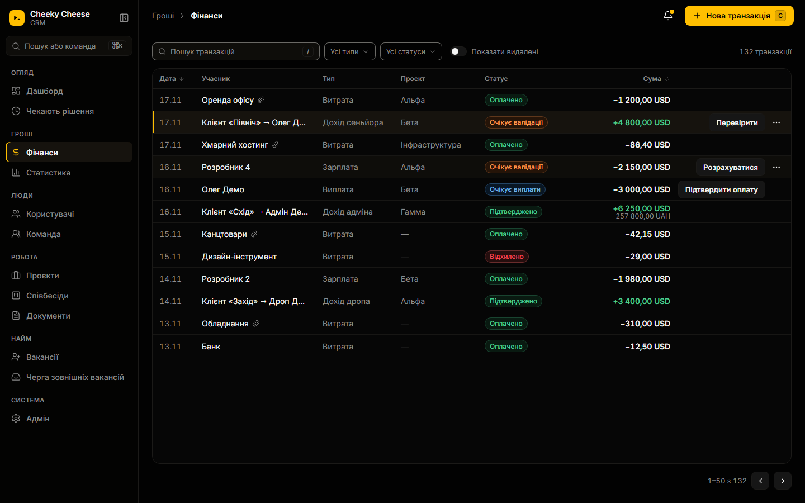

# Screen: Finance list (CRM redesign v2, Task 1.2)

> Per-screen artifact (CRM redesign v2). Coder-ready spec of the finance list on every device class.
> The coder relies ONLY on this file + `assets/` (no browser access). Template:
> `docs/design/screens/_TEMPLATE.md`. Visual and interaction language: `docs/design/foundation.md`,
> `docs/design/screens/_foundation/primitives-v2.md`, `docs/design/screens/_foundation/shell-v2.md`.

| Field              | Value                                                                                                     |
| ------------------ | --------------------------------------------------------------------------------------------------------- |
| Screen             | Finance list («Фінанси»): the transaction list and its role variants                                      |
| Route / trigger    | `/finance` (tab «Фінанси»; sidebar «Гроші → Фінанси»; deep link `/finance?status=PENDING`)                |
| Roles              | ADMIN, ACCOUNTANT, SENIOR, HR, JUNIOR, DROP (each a variant below)                                        |
| Claude Design URL  | none — `design-gate: degraded` (Claude Design cannot be driven headless; HTML prototypes, Playwright PNG) |
| Status             | Draft (Mode A), pending orchestrator review                                                               |
| Last synced commit | `11554c089` (foundation v2, #1319)                                                                        |
| Out of scope       | The add / edit transaction sheet (Task 1.3, designed in parallel): only its entry points are shown here   |

All names and amounts in the mockups are invented seed-like data («Олег Демо», «Розробник 4»,
«Клієнт «Північ»»). Assets: `assets/finance-list/*.png`, generated by `assets/src/render.mjs`
(`node render.mjs [name-filter]`; sources `finance-list.mjs`, `states.mjs`, `roles.mjs`).

---

## 1. Current (capture-grounded inventory)

> Baseline device captures and the network baseline: **pending** (Wave 0 capture run). This
> inventory is read from the code of `routes/_authenticated/finance/index.tsx` and its components.
> No line numbers: components are named by symbol.

### 1.1 Branches of the route

`/finance` renders one of four bodies, chosen by role:

| Role              | Body today                                                                                                                                               |
| ----------------- | -------------------------------------------------------------------------------------------------------------------------------------------------------- |
| ADMIN, ACCOUNTANT | Header «Фінанси» + «Нова транзакція» → `TransactionsTable` (search, type and status selects, «Показати видалені» switch, date/amount sort, `Pagination`) |
| SENIOR            | Same as ADMIN, scoped by the API to own projects; plus `CompanySharePayoutStrip` and the outline header button «Виплатити (N)» (Wallet icon)             |
| HR                | Own salaries only (`SALARY` where receiver = self): table Сума / Місяць / Дата / Статус; empty «Виплат ще немає»; no create                              |
| JUNIOR            | Own salaries: table Сума / Проєкт / Місяць / Дата / Статус / Хеш транзакції (hash truncated to 14 chars + tooltip); empty «Виплат ще немає»; no create   |
| DROP              | `DropFinancePage`: `DropBalanceCard`, «МОЇ ДОХОДИ» (status + period filters, server paging 20), «ПЛАТЕЖІ НА КОМПАНІЮ», «Зареєструвати дохід»             |

`KpiCards` is **not** rendered on `/finance` (dashboards only). There is **no chart** on this
route, so "chart follows the filter" does not apply (§11, OP-2).

### 1.2 Row actions (`TransactionRow`) — every gated action, with its predicate

| Action (uk)                 | Shown when                                                                             | Opens                        |
| --------------------------- | -------------------------------------------------------------------------------------- | ---------------------------- |
| «Перевірити»                | ADMIN/ACCOUNTANT · `SENIOR_INCOME` · `PENDING`                                         | `ValidateDialog`             |
| «Виплатити»                 | SENIOR · own `SENIOR_INCOME` · `VALIDATED` · no payout request yet                     | payout initiation            |
| «Оплатити»                  | SENIOR · `PAYOUT` · `PENDING_PAYMENT` · sender = self                                  | `PayoutDetailDialog`         |
| «Підтвердити оплату»        | ADMIN/ACCOUNTANT · `PAYOUT` · `PENDING_PAYMENT`                                        | `ConfirmPayoutDialog`        |
| «Виправити»                 | SENIOR · `SENIOR_INCOME` · `REJECTED`                                                  | `EditSeniorIncomeDialog`     |
| «Розрахуватися» (salary)    | ADMIN · `SALARY` · `PENDING`                                                           | `PaySalaryDialog`            |
| «Додати частину зарплати»   | ADMIN/ACCOUNTANT · `SALARY`                                                            | salary-part flow             |
| «Розрахуватися» (payout)    | ADMIN/ACCOUNTANT · `SENIOR_PENDING_PAYOUT` / `DROP_PENDING_PAYOUT` · `PENDING_PAYMENT` | `SettleSeniorPayoutDialog`   |
| «Редагувати» (icon)         | ADMIN · not `PAYOUT`/`PAYOUT_ADMIN` · (`PENDING_PAYMENT` or no payout request)         | `AdminEditTransactionDialog` |
| «Видалити» (icon)           | same predicate as «Редагувати»                                                         | `DeleteTransactionDialog`    |
| «Відновити»                 | ADMIN · deleted row                                                                    | `RestoreTransactionDialog`   |
| «Прикріпити / Замінити чек» | `canAttachReceipt` (`receipt-permissions.ts`)                                          | `AttachReceiptSheet`         |
| Row click                   | everyone                                                                               | `TransactionDetailDialog`    |

Row facts shown today: type, participant / project, amount (+ UAH equivalent for non-USD/USDT),
date, status pill, «Сплачено X · до сплати Y» for partially settled rows, senior share «Частка: N%»
(ADMIN, ACCOUNTANT, own SENIOR) with its source tooltip, «Видалено» marker, receipt clip.

### 1.3 Modals and dual mounts

Modals mounted by the route: `CreateTransactionDialog` (Task 1.3), `ValidateDialog`,
`TransactionDetailDialog` (×3 mounts), `AdminEditTransactionDialog`, `DeleteTransactionDialog`,
`RestoreTransactionDialog`, `PaySalaryDialog`, `SettleSeniorPayoutDialog`, `ConfirmPayoutDialog`,
`PayoutDetailDialog`, `EditSeniorIncomeDialog`, `CompanySharePayoutModal`, `AttachReceiptSheet`.
None of them is redesigned here; this screen only fixes **where each one is entered from** (§3.4).

Dual-mount pair today: `CascadeImpactPanel` renders a `sm:hidden` mobile row next to the desktop
row (inside the delete / edit dialogs) — Task 1.3's concern, noted in §11 OP-5.

### 1.4 Filters and URL today

Only `?status` is in the URL (`validateSearch` → `FinanceSearch`). Search, type, status (after the
first change), deleted switch and page are local state in `TransactionsTable`. All rows are fetched
and paged client-side at 50 (`usePaginatedFilter`). The «Нова транзакція» label is icon-only below
`sm`. There is no error branch: a failed `['transactions', …]` query renders as the empty table.

### 1.5 Capability trace (both directions)

Every capability of today maps to a place in the redesign; every element of the redesign maps back
to a capability of today (or is marked **new UI, no new data**).

| Today                                    | Phone (< 640)                                      | Tablet (640–1023)   | Desktop (≥ 1024)                                     |
| ---------------------------------------- | -------------------------------------------------- | ------------------- | ---------------------------------------------------- |
| «Нова транзакція»                        | FAB «+» (opens 1.3)                                | rail «+»            | header primary + `C`                                 |
| Search                                   | search field (`q`)                                 | same                | toolbar search + `/`                                 |
| Type select (19 types)                   | filter sheet → «Тип»                               | same                | toolbar «Усі типи» listbox                           |
| Status select (7 statuses), `?status`    | filter sheet → «Статус», active chip               | same                | toolbar «Усі статуси» listbox                        |
| «Показати видалені» (ADMIN/ACCOUNTANT)   | filter sheet toggle, chip «Видалені»               | same                | toolbar switch                                       |
| Sort date / amount                       | chip «Дата» → sheet «Сортування»                   | same                | sortable headers Дата / Сума                         |
| `Pagination` (50)                        | incremental list footer (same 50-row pages)        | same                | pager «1–50 з 132»                                   |
| Every row action (§1.2)                  | detail page actions (`detail-375`) + swipe (ADMIN) | detail page actions | inline primary (≥ 1280) + «…» menu (`row-menu-1440`) |
| Row click → `TransactionDetailDialog`    | push detail page                                   | push detail page    | dialog (unchanged)                                   |
| UAH equivalent                           | second amount line                                 | same                | second amount line                                   |
| «Сплачено X · до сплати Y», «Частка: N%» | detail page                                        | detail page         | row tooltip + detail                                 |
| Receipt clip / attach                    | clip in meta line; «Прикріпити чек» in detail      | same                | clip after title; menu «Прикріпити чек»              |
| «Видалено» marker, «Відновити»           | «Видалено» pill; «Відновити» in detail             | same                | pill; inline «Відновити»                             |
| SENIOR strip + «Виплатити (N)»           | strip card + full-width «Виплатити (N)»            | same                | strip above table; header secondary                  |
| HR / JUNIOR salary tables                | salary list                                        | salary list         | salary table                                         |
| DROP page (balance, incomes, payments)   | stacked sections                                   | stacked sections    | balance + two tables                                 |
| — (new UI)                               | day section headers, pull-to-refresh, drafts row   | same                | pinned draft row                                     |
| — (new UI)                               | error and partial-rate states                      | same                | same                                                 |

No capability is removed. No new business data, no new KPI, no new query.

## 2. Design direction

- **Purpose:** find a transaction and act on it; the list is a work queue for ADMIN/ACCOUNTANT
  (validate, confirm payments) and a ledger for everyone else.
- **Audience:** repeat daily use; ACCOUNTANT lands from the deep link `?status=PENDING`.
- **Tone:** dense, quiet, scannable. Amount is the loudest element of a row; status is quiet unless
  it needs work.
- **Memorable detail:** the phone list reads like a bank statement — day sections, one line of
  facts, the amount right-aligned in tabular figures, and a status pill **only** when the
  transaction still needs someone (`VALIDATED` and `PAID` stay silent).
- **Constraints:** foundation v2 tokens and primitives; shadcn/ui; Lingui `uk` + `en`; WCAG 2.2 AA;
  320–1440.

## 3. Layout per device class

Shells come from `shell-v2.md`: phone tab bar + FAB, tablet 80 px rail with «+», desktop 248 px
sidebar with breadcrumb «Гроші › Фінанси». One layout is mounted at a time (`ByDevice`).

### 3.1 Phone (< 640) — `main-320`, `main-375`


- Large title «Фінанси», bell, search icon in the bar.
- Search field «Пошук транзакцій» (16 px input), then a chip row: «Фільтри» (badge = active
  filter count) + active filter chips with ✕ + sort chip «↓ Дата».
- List grouped by day: sticky section header («Сьогодні», «Вчора», «15 листопада»). Day totals are
  not shown (§11 OP-6).
- Row (two-line list row, 64 px lead icon inset):
  - line 1: title (clamp 2 lines) + amount (tabular, `+` green for income, `−` default);
  - line 2: `time · type · Проєкт «…»` + receipt clip, one line, ellipsis;
  - optional UAH equivalent under the amount;
  - optional status pill, only for statuses other than `VALIDATED` / `PAID` (§11 OP-7);
  - an amount longer than 14 characters drops under the title (`long-320`).
- Title rule: the non-company party («Оренда офісу», «Розробник 4»); for incomes `Клієнт → receiver`.
- FAB «+» → Task 1.3 sheet. Tab bar per role (§5).

### 3.2 Tablet (640–1023) — `main-768`

Rail (80 px) with «+» on top; one pane with the phone list at a 640 px max-width column, larger
gutters. Tapping a row pushes the detail page. Filters: the same bottom sheet, presented as a
centred sheet ≤ 560 px wide.

### 3.3 Desktop (≥ 1024) — `main-1024`, `main-1440`



- Header: breadcrumb, bell, primary «Нова транзакція» with `C` key hint (SENIOR: secondary
  «Виплатити (N)» left of it).
- Toolbar (one row, 32 px controls): search (`/` focuses), «Усі типи», «Усі статуси» listboxes
  (an active one turns yellow with ✕), «Показати видалені» switch (ADMIN/ACCOUNTANT), «Скинути»
  when anything is active, count at the right («132 транзакції», or «4 з 132» when filtered).
- Table, fixed layout, 40 px rows: Дата (76) · Учасник (flex, ellipsis, tooltip `from → to`) ·
  Тип (140; at < 1280 «Тип · проєкт» 150) · Проєкт (130, ≥ 1280 only) · Статус (180 / 150) ·
  Сума (176 / 140, right) · Дії (236 at ≥ 1280, 52 below).
- Actions: at ≥ 1280 the primary action of the row is an inline secondary button, and «…» shows
  on hover / focus. At 1024–1279 the inline button does not fit: the primary action becomes the
  first «…» menu item and «…» is always visible on rows that have one.
- Pager «1–50 з 132» with previous / next (32 px); page is in the URL.

### 3.4 Entry points of the modals

| Modal                                                                                                                                  | Phone / tablet               | Desktop                   |
| -------------------------------------------------------------------------------------------------------------------------------------- | ---------------------------- | ------------------------- |
| `CreateTransactionDialog` (Task 1.3)                                                                                                   | FAB «+» / rail «+»           | header primary, `C`       |
| `TransactionDetailDialog`                                                                                                              | pushed page (`detail-375`)   | row click / `Enter`       |
| `ValidateDialog`, `ConfirmPayoutDialog`, `PaySalaryDialog`, `SettleSeniorPayoutDialog`, `PayoutDetailDialog`, `EditSeniorIncomeDialog` | detail page buttons          | inline button or «…» item |
| `AdminEditTransactionDialog`                                                                                                           | detail «Редагувати», swipe   | «…» «Редагувати», `E`     |
| `DeleteTransactionDialog`                                                                                                              | detail «…» «Видалити», swipe | «…» «Видалити…»           |
| `RestoreTransactionDialog`                                                                                                             | detail «Відновити»           | inline «Відновити»        |
| `AttachReceiptSheet`                                                                                                                   | detail «Прикріпити чек»      | «…» «Прикріпити чек»      |
| `CompanySharePayoutModal`                                                                                                              | strip «Оплатити»             | strip «Оплатити»          |

## 4. States

| State                   | What it shows                                                                                                                                       | Assets                                     |
| ----------------------- | --------------------------------------------------------------------------------------------------------------------------------------------------- | ------------------------------------------ |
| Loading                 | Skeleton rows in the list / table; title, search and filters stay interactive                                                                       | `loading-375`, `loading-1440`              |
| Empty (no transactions) | «Транзакцій ще немає» + one line pointing at the single create entry; no filters shown                                                              | `empty-375`, `empty-1440`                  |
| Empty (filtered)        | «Нічого не знайдено» / «Змініть пошук або скиньте фільтри.» + «Скинути фільтри»                                                                     | `filtered-375`, `filtered-1440`            |
| Error                   | «Не вдалося завантажити транзакції» + reassurance + «Спробувати ще» (re-runs the same query). **New**: today the error renders as an empty table    | `error-375`, `error-1440`                  |
| Partial (rates down)    | Rows render; non-USD rows keep their own currency; notice «Курс недоступний — суми показано у валюті транзакції.» + «Повторити»                     | `partial-375`, `partial-1440`              |
| Offline / unknown       | Foundation offline banner; the cached list stays readable; actions that write are disabled with the banner's reason                                 | `offline-375`, `offline-1440`              |
| Filters open            | Phone: bottom sheet (Тип, Статус, Сортування, «Показати видалені»), footer «Показати N» + «Скинути». Desktop: listbox under the toolbar button      | `filters-375`, `filters-1440`              |
| Unsaved draft           | A create that failed to save is pinned on top («Не збережено · Витрата», «Відкрити»); FAB / CTA carries a dot. Draft logic: foundation `money-form` | `drafts-375`, `drafts-1440`                |
| With deleted            | Deleted rows at 55 % opacity with «Видалено» pill; chip «Видалені» (phone) / switch on (desktop)                                                    | `deleted-375`, `deleted-1440`              |
| Long content            | 2-line title clamp, stacked 7-figure amount, long status wraps; desktop ellipsis + tooltip                                                          | `long-320`, `long-1440`                    |
| Permission-limited      | Role variants (§5): no create for HR/JUNIOR, no deleted toggle except ADMIN/ACCOUNTANT, actions per §1.2 predicates                                 | `role-*`                                   |
| Refreshing              | Pull-to-refresh spinner above the list; the list never blanks                                                                                       | `ptr-375`                                  |
| Detail / swipe / menu   | Phone detail push with every gated action; ADMIN trailing swipe «Редагувати» / «Видалити»; desktop row menu                                         | `detail-375`, `swipe-375`, `row-menu-1440` |

## 5. Role variants

| Role       | Phone tab / entry                                         | Create entry                       | Filters                                                | Specifics                                                                                                                                                                                      | Assets                |
| ---------- | --------------------------------------------------------- | ---------------------------------- | ------------------------------------------------------ | ---------------------------------------------------------------------------------------------------------------------------------------------------------------------------------------------- | --------------------- |
| ADMIN      | tab 1 of `['/finance','/users','/stats','/admin']`        | FAB / «Нова транзакція»            | all + deleted                                          | swipe edit / delete; all §1.2 actions                                                                                                                                                          | `main-*`, `swipe-375` |
| ACCOUNTANT | tab 1 of `['/finance','/stats','/','/projects']`          | FAB / «Нова транзакція»            | all + deleted; deep link sets «Очікує валідації»       | inline «Перевірити» (`SENIOR_INCOME`), «Додати частину зарплати» (`SALARY`)                                                                                                                    | `role-accountant-*`   |
| SENIOR     | tab 2 of `['/','/finance','/team','/projects']`           | FAB / «Нова транзакція»            | search, type, status                                   | `CompanySharePayoutStrip` (phone: card above the list; desktop: above the toolbar); «Виплатити (N)» (phone: full-width secondary; desktop: header secondary); per-row «Виплатити» / «Оплатити» | `role-senior-*`       |
| HR         | no finance tab: pushed page from «Ще», back               | none                               | none                                                   | salary list by month: title = month, meta «Зарплата · виплачено 05.11», pill only when not paid; desktop table Місяць / Дата виплати / Статус / Сума                                           | `role-hr-*`           |
| JUNIOR     | tab 2 of `['/project','/finance','/legend','/documents']` | none                               | none                                                   | as HR + project («Проєкт «Альфа» · виплачено 05.11»); desktop column «Хеш транзакції» with copy button; phone shows the hash in the detail only (§11 OP-8)                                     | `role-junior-*`       |
| DROP       | tab 2 of `['/','/finance','/documents','/team']`          | FAB / header «Зареєструвати дохід» | status + period (server, `['drop','incomes',filters]`) | `DropBalanceCard` on top; «Мої доходи»; «Платежі на компанію» with failed-transfer tooltip; full DROP state set in §11 OP-4                                                                    | `role-drop-*`         |


## 6. Interaction and motion

### 6.1 URL schema (filters live in the URL)

```
/finance?q=хостинг&type=EXPENSE&status=PENDING&deleted=1&sort=amount&dir=asc&page=2
```

| Param     | Values                        | Default (omitted) | Notes                                                               |
| --------- | ----------------------------- | ----------------- | ------------------------------------------------------------------- |
| `q`       | free text                     | —                 | search over party, project, notes (same fields as today)            |
| `type`    | a `TYPE_LABEL_MESSAGES` key   | all               |                                                                     |
| `status`  | a `STATUS_LABEL_MESSAGES` key | all               | keeps today's deep link `?status=PENDING`                           |
| `deleted` | `1`                           | off               | ignored for roles other than ADMIN / ACCOUNTANT                     |
| `sort`    | `date` \| `amount`            | `date`            |                                                                     |
| `dir`     | `desc` \| `asc`               | `desc`            |                                                                     |
| `page`    | integer ≥ 1                   | 1                 | desktop / pager only; the phone ignores it and resets on any change |

`validateSearch` parses with Zod and drops unknown values (never throws). Every change writes with
`replace`, so Back leaves the screen instead of stepping through filter history. DROP keeps its
own `status` + `period` params with the same mechanism (server params unchanged).

### 6.2 Phone and tablet

- **Row tap** → pushed detail page (foundation push, 280 ms); edge-swipe back.
- **Pull-to-refresh** (`ptr-375`): 64 px threshold, spinner above the list, the list stays in place;
  re-fetches the keys of §9.
- **Filters** → bottom sheet (medium detent; centred ≤ 560 px on tablet). Pickers open nested
  lists; the footer «Показати N» applies (N counts the already-loaded rows), «Скинути» clears.
  Active filters become chips with ✕ (removes at once).
- **Sort chip** «↓ Дата» opens the «Сортування» picker («Спочатку нові / старі / більші / менші»).
- **Search**: 250 ms debounce, writes `q`.
- **Swipe (ADMIN, `swipe-375`)**: trailing «Редагувати» / «Видалити»; full swipe does nothing
  destructive — «Видалити» opens `DeleteTransactionDialog`. Every swipe action is also on the detail
  page.
- **Long list**: renders 50 rows, then the next 50 from memory as the footer scrolls into view
  (footer button «Показати ще» as the non-scroll fallback). No extra request.

### 6.3 Desktop

- Keyboard: `/` focuses search, `C` opens create (Task 1.3), `↑` / `↓` move a roving row focus,
  `Enter` opens the detail, `E` edits (ADMIN), `Shift+F10` or the context-menu key opens «…».
- Sortable headers Дата / Сума toggle `dir`; the column already sorted shows its arrow.
- Row hover / focus shows «…»; rows with a primary action keep it visible (§3.3).
- Listboxes close on select; `Esc` closes and returns focus to the trigger.

### 6.4 Motion

Row enter 80 ms ease-out (as today, `motion.tr`); push 280 ms; sheet per foundation. With
`prefers-reduced-motion`: push and sheet become a 120 ms fade, the PTR spinner does not rotate,
rows appear without offset.

## 7. Accessibility (WCAG 2.2 AA)

- **Structure.** Day headers are `h2`; the phone list is `role="list"`, each row a link to the
  detail whose name reads «title, amount, status» (status included even when the pill is hidden,
  §11 OP-7). Desktop is a real `<table>` with `aria-sort` on sortable headers and a visually hidden
  «Дії» header.
- **Targets.** Phone rows ≥ 64 px, chips and buttons 44 px, FAB 56 px. Desktop controls are 32 px,
  row buttons 28–32 px (≥ 24 px, SC 2.5.8). Phone inputs are 16 px (no iOS zoom).
- **Names.** Inline row buttons carry the row in the name: «Перевірити: Клієнт «Північ», +4 800,00
  USD». «…» is «Інші дії» with `aria-haspopup="menu"`; the menu is «Дії з транзакцією» with roving
  focus, `Esc` returns focus to «…». Icon-only controls (copy hash, receipt clip, rail «+») have
  labels.
- **Not by colour only.** Status is always pill text; amount sign is the `+` / `−` glyph, colour is
  secondary.
- **Gestures (SC 2.5.7).** Swipe actions and pull-to-refresh have single-pointer equivalents: detail
  page buttons; refetch on focus and the retry buttons of the error / offline / partial states.
- **Dialogs.** The filter sheet and every modal trap focus, close on `Esc` / close button, and return
  focus to the trigger.
- **Live regions.** The result count («4 з 132») is `aria-live="polite"`; the error, partial and
  offline notices are `role="status"`.
- **Reflow / zoom.** 320 px and 400 % zoom fall back to the phone layout; nothing scrolls
  horizontally except the desktop table inside its own region.
- **Contrast.** Foundation tokens (muted text ≥ 4.5:1 on card); the 55 % deleted-row opacity keeps
  the «Видалено» pill and the «Відновити» button at full opacity.

## 8. Strings (`uk` / `en`)

`existing` = msgid already in `packages/shared/src/i18n/locales`; `new` = to add (en written anew,
not translated). The DROP and `CompanySharePayoutStrip` strings are all existing and unchanged.

| uk                                                                         | en                                                                         | Status                            |
| -------------------------------------------------------------------------- | -------------------------------------------------------------------------- | --------------------------------- |
| Фінанси                                                                    | Finance                                                                    | existing                          |
| Нова транзакція                                                            | New transaction                                                            | existing                          |
| Пошук транзакцій                                                           | Search transactions                                                        | new (replaces «Пошук…»)           |
| Фільтри / Сортування / Скинути / Скинути фільтри                           | Filters / Sort by / Reset / Reset filters                                  | existing                          |
| Усі типи / Усі статуси / Показати видалені / Видалено                      | All types / All statuses / Show deleted / Deleted                          | existing                          |
| Видалені (chip)                                                            | Deleted                                                                    | new                               |
| Сьогодні / Вчора                                                           | Today / Yesterday                                                          | new                               |
| Спочатку нові / старі / більші / менші                                     | Newest first / Oldest first / Largest first / Smallest first               | new                               |
| Показати {count}                                                           | Show {count}                                                               | new                               |
| Показати ще                                                                | Show more                                                                  | new                               |
| {count, plural, one {# транзакція} few {# транзакції} many {# транзакцій}} | {count, plural, one {# transaction} other {# transactions}}                | new                               |
| {shown} з {total}                                                          | {shown} of {total}                                                         | new                               |
| {from}–{to} з {total}                                                      | {from}–{to} of {total}                                                     | new                               |
| Транзакцій ще немає                                                        | No transactions yet                                                        | new                               |
| Натисніть «+», щоб додати першу.                                           | Tap + to add the first one.                                                | new                               |
| Створіть першу кнопкою «Нова транзакція».                                  | Use New transaction to add the first one.                                  | new                               |
| Нічого не знайдено                                                         | No results                                                                 | existing                          |
| Змініть пошук або скиньте фільтри.                                         | Change the search or reset the filters.                                    | new                               |
| Не вдалося завантажити транзакції                                          | Couldn’t load transactions                                                 | new                               |
| Сервер не відповів. Нічого не змінено — спробуйте ще раз.                  | The server didn’t respond. Nothing was changed — try again.                | new                               |
| Спробувати ще                                                              | Try again                                                                  | new                               |
| Курс недоступний — суми показано у валюті транзакції.                      | Exchange rate unavailable — amounts are shown in the transaction currency. | new                               |
| Повторити                                                                  | Retry                                                                      | existing                          |
| Оновлення (PTR spinner label)                                              | Refreshing                                                                 | new                               |
| Учасник / Тип · проєкт                                                     | Member / Type · project                                                    | new (split of «Учасник / Проєкт») |
| Дата / Сума / Статус / Тип / Проєкт / Місяць / Дії                         | Date / Amount / Status / Type / Project / Month / Actions                  | existing                          |
| Дата виплати                                                               | Payout date                                                                | new                               |
| Хеш транзакції                                                             | Transaction hash                                                           | existing                          |
| Копіювати хеш                                                              | Copy hash                                                                  | new                               |
| Інші дії                                                                   | More actions                                                               | new                               |
| Дії з транзакцією                                                          | Transaction actions                                                        | new                               |
| Перевірити / Виплатити / Оплатити / Підтвердити оплату                     | Check / Pay out / Pay / Confirm payment                                    | existing (see OP-13)              |
| Виправити / Розрахуватися / Додати частину зарплати / Відновити            | Fix / Settle / Add salary part / Restore                                   | existing                          |
| Відкрити / Редагувати / Видалити / Прикріпити чек / Чек / Отримувач        | Open / Edit / Delete / Attach receipt / Receipt / Recipient                | existing                          |
| Платник / Створив                                                          | Payer / Created by                                                         | new                               |
| Зарплата · виплачено {date} / ще не виплачено                              | Salary · paid {date} / not paid yet                                        | new                               |
| Переказ на рахунок компанії (DROP payment row title, phone)                | Transfer to the company account                                            | new                               |
| Очікує валідації / Підтверджено / Оплачено / Очікує виплати / Відхилено    | Awaiting validation / Validated / Paid / Awaiting payout / Rejected        | existing                          |
| Виплат ще немає                                                            | No payouts yet                                                             | existing                          |

DROP headers reuse the existing msgids «МОЇ ДОХОДИ» / «ПЛАТЕЖІ НА КОМПАНІЮ» (en «MY INCOME» /
«PAYMENTS TO THE COMPANY»). Draft-row strings come from the foundation `money-form` spec.

## 9. Data and network

- **One query key per dataset for both layouts** (`ByDevice` mounts one layout at a time):
  `['transactions', 'with-deleted' | 'active']`, `['exchange-rate', 'today']`; the SENIOR strip keeps
  its own existing query; DROP keeps `DROP_SUMMARY_QUERY_KEY`, `['drop', 'incomes', filters]`,
  `['drop', 'payments']`. HR and JUNIOR read the same transactions query (own `SALARY` rows).
- **Filters, search, sort, page and day grouping are client derivations** over the cached array:
  changing them costs 0 requests (as today). Only the deleted toggle switches the key (as today).
- **Pull-to-refresh / retry** = `invalidateQueries` on the keys above.
- **Error state** reads `isError` of the existing query; **partial** = rates query failed while
  transactions succeeded. No new endpoint, no new field.
- No new business data, no new KPI, no removed capability (§1.5).
- **Network baseline: pending** (Wave 0 capture run).

## 10. Self-score (rubric-calibration)

Scale 0–10 per criterion; weights from `rubric-calibration.md`. Data viz (7) is N/A (no chart on the
route), so totals are normalised over 93.

| Criterion (weight) | Phone  | Tablet | Desktop | Note                                                                    |
| ------------------ | ------ | ------ | ------- | ----------------------------------------------------------------------- |
| Time-to-task (15)  | 9      | 8      | 9       | deep link lands on the queue; one tap to the action via detail / inline |
| Never blocks (15)  | 9      | 9      | 9       | list never blanks on refresh; partial and offline keep rows readable    |
| Navigation (10)    | 9      | 8      | 9       | URL state, Back leaves the screen                                       |
| Forms (10)         | 8      | 8      | 8       | filter sheet / listboxes; the money form is Task 1.3                    |
| Lists (10)         | 7      | 7      | 7       | no bulk select, no inline edit                                          |
| Sheets (8)         | 8      | 8      | 7       | desktop row menu, no side panel for the detail                          |
| States (10)        | 9      | 9      | 9       | all states mocked; DROP state set open (OP-4)                           |
| Platform (8)       | 8      | 7      | 9       | PTR, swipe, keyboard; tablet is a widened phone list                    |
| A11y (7)           | 8      | 8      | 8       |                                                                         |
| **Total / 100**    | **84** | **81** | **84**  |                                                                         |

Weakest criterion: **Lists** on every class (no bulk validate for ACCOUNTANT, no inline edit).
Hard floor (criteria 2 and 4 ≥ 5): met.

## 11. Open points

Each with a recommendation; none blocks Task 1.2.

- **OP-1 Notes as the row title.** The phone title is the party, notes stay in the detail. _Rec:_
  keep.
- **OP-2 "Chart follows the filter".** There is no chart on `/finance`. _Rec:_ do not add one (it
  would be a new KPI); revisit if statistics move onto this route.
- **OP-3 New filter dimensions** (project, period, currency — shown in the foundation demo). Not in
  today's screen. _Rec:_ do not add in this task.
- **OP-4 DROP full state set.** Only the main frames are mocked. _Rec:_ reuse the existing
  `DropBalanceCard` error and DROP empty strings in the §4 patterns; mock in a follow-up.
- **OP-5 `CascadeImpactPanel` `sm:hidden` dual mount** inside the delete / edit dialogs. _Rec:_
  Task 1.3 replaces it with `ByDevice`.
- **OP-6 Day totals.** Dropped: mixed currencies make a sum misleading. _Rec:_ keep out.
- **OP-7 No pill for `VALIDATED` / `PAID` on phone rows.** _Rec:_ keep; the row's accessible name
  and the detail still state it.
- **OP-8 JUNIOR transaction hash on phone** only in the detail. _Rec:_ keep.
- **OP-9 Server paging and a server search param.** Today all rows load and page client-side at 50.
  _Rec:_ keep for now; move to server paging with the same URL schema when the list passes ~2 000
  rows.
- **OP-10 Inline action at 1024–1279** moves into the «…» menu. _Rec:_ accept.
- **OP-11 DROP «Дія» column** is empty today. _Rec:_ drop it (the mockup does).
- **OP-12 SENIOR title for own income** shows «Клієнт → self». _Rec:_ show only the client when the
  receiver is the current user.
- **OP-13 en of «Перевірити» is "Check"**, while the glossary term is validation. _Rec:_ "Validate";
  route to copy-reviewer.
- **OP-14 PNG quantisation.** ImageMagick was not available; PNGs are unquantised. _Rec:_ quantise in
  a later pass, no content change.
- **OP-15 Baseline captures and network baseline** are pending (Wave 0).
