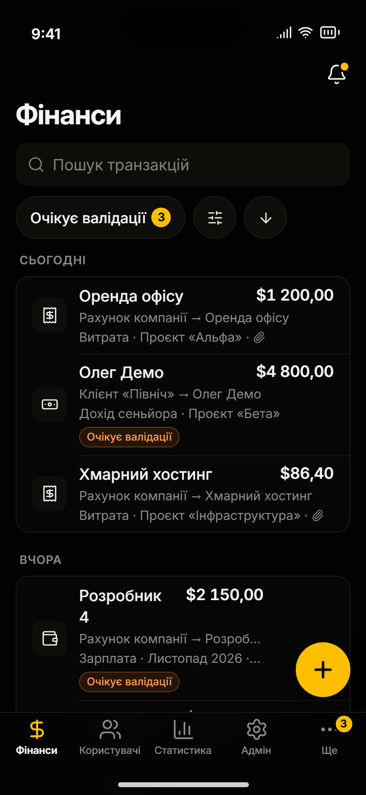
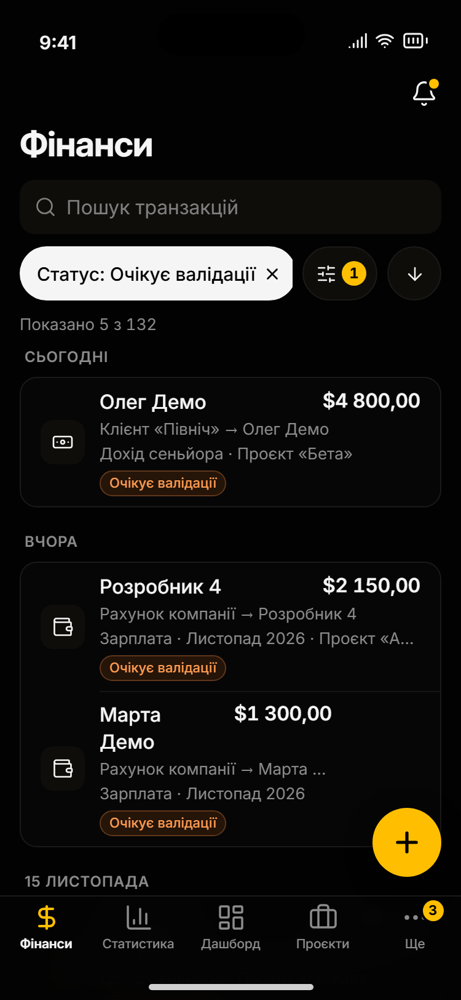

# Screen: Finance list (CRM redesign v2, Task 1.2)

> Per-screen artifact (CRM redesign v2). Coder-ready spec of the finance list on every device class.
> The coder relies ONLY on this file + `assets/` (no browser access). Template:
> `docs/design/screens/_TEMPLATE.md`. Visual and interaction language: `docs/design/foundation.md`,
> `docs/design/screens/_foundation/primitives-v2.md`, `docs/design/screens/_foundation/shell-v2.md`.

| Field              | Value                                                                                                     |
| ------------------ | --------------------------------------------------------------------------------------------------------- |
| Screen             | Finance list («Фінанси»): the transaction list and its role variants                                      |
| Route / trigger    | `/finance` (tab «Фінанси»; sidebar «Гроші → Фінанси»; deep links `?status=PENDING`, `?month=2026-11`)     |
| Roles              | ADMIN, ACCOUNTANT, SENIOR, HR, JUNIOR, DROP (each a variant below)                                        |
| Claude Design URL  | none — `design-gate: degraded` (Claude Design cannot be driven headless; HTML prototypes, Playwright PNG) |
| Status             | Draft (Mode A), council rounds 1 and 2 fixes applied (§16, §17 ledgers)                                   |
| Last synced commit | `11554c089` (foundation v2, #1319)                                                                        |
| Out of scope       | The add / edit transaction sheet (Task 1.3, designed in parallel): only its entry points are shown here   |

All names and amounts in the mockups are invented seed-like data («Олег Демо», «Розробник 4»,
«Клієнт «Північ»»); no real person, company, email or money. Assets: `assets/finance-list/*.png`,
generated by `assets/src/render.mjs` (`node render.mjs [name-filter]`; sources `finance-list.mjs`,
`states.mjs`, `roles.mjs`, `round1.mjs`). Every frame is listed once in §15 (the frame index); a
name written as `primitives-v2/<frame>` or `shell-v2 <frame>` is a foundation frame, not one of ours.

**Fixture conventions (M17).** Today is 17 November 2026 (Kyiv). One fixture rate: **1 USD = 41,25
UAH** (USDT is 1:1), so every «≈» figure is the original amount divided by 41,25. The full ADMIN list
is 132 transactions; a frame that shows fewer rows says which slice it is. The fixture module asserts
its own sums (`assertFixtures()` in `assets/src/round1.mjs`): the DROP balance card against its rows,
pager and count labels against the rows drawn.

## Assumptions

Each line is a decision the orchestrator made at council round 1 (M1–M17) or an A1 decision of
this round (A-1…). They ride into the PR body unchanged.

- **M1** Month filter `month=YYYY-MM` in the URL, Zod-validated, an invalid value dropped; a client
  filter applied before paging, `page` resets to 1 on change. Match rule = the stats bucket rule
  (§1.6 a). No picker: it arrives by link and leaves by a removable chip. ADMIN, ACCOUNTANT, SENIOR
  honour it; HR and JUNIOR ignore it; DROP keeps its server `period`. A month with no rows has its own
  empty state with «Показати всі місяці», which removes only `month` (§6.1, `month-*`).
- **M2** Row writes (validate, confirm payment, mark paid / settle, delete, restore): `retry: 0`, never
  retried automatically, no optimistic status change; pending on the row; a definite failure keeps
  the dialog with its values and an inline alert; an unknown outcome leaves a persistent row and
  detail marker until a refetch settles it or the user acknowledges it; the success toast names
  amount and counterparty; exact invalidation keys and the leaving-the-filter rule (§9.2).
- **M3** The full-page error appears only with no data. With cached rows a failed refetch or
  pull-to-refresh keeps the rows and adds an inline `role="alert"` notice with «Повторити» and a
  "last updated" stamp. Query timing values are today's (§1.6 d, §9.3).
- **M4** Offline follows shell v2: entry points and row actions stay enabled; an attempt offline ends
  in the definite alert with values kept. "Write actions disabled" is removed (§4, `offline-*`).
- **M5** Sign and arrow are a type × viewer table derived from today's row code (§3.5). Today's code
  draws **no sign and no arrow on the amount** for any viewer, so no frame does; direction is carried
  by the type word and the payer → receiver order. Transfers have their own row (no sign, type word
  «Переказ»). The glossary-vs-display question was OP-17; round 2 removed it, because P2 states the
  direction once, as text (§3.5).
- **M6** The row leads with today's lead figure, the USD conversion («$4 800,00»); a converted figure
  is marked «≈», the second line is the original amount. Amount sort orders by the displayed USD value
  and is disabled with a reason while rates are missing. **Behaviour change** against today's
  raw-amount sort (`compareTxByAmount`).
- **M7** Tablet follows shell v2 §3: 640–899 single pane (push), 900–1023 list + detail pane; every §4
  state has a tablet rule or frame; one swipe rule for tablet (§6.2).
- **M8** Containers per class are one table (§3.6): phone = detent sheet / action sheet for confirms;
  tablet and desktop = centred dialog for confirms; desktop row detail = foundation side panel.
- **M9** `(pointer: coarse)` at any width: rows 52 px, «…» and the inline primary always visible at
  44 px, pager and toolbar controls 44 px, input text 16 px (§3.7, `main-touch-1180`).
- **M10** Swipe reveals the viewer's primary row action per §1.2, opens the same dialog, never
  performs the write; a row with no action does not swipe; every action has a non-swipe path (§6.2).
- **M11** No field of today loses its home (§3.8): DROP payment `txHash` (desktop column with copy,
  phone detail), `salaryMonth`, rejection reason, deletion reason, share source — a meta line or a
  detail row reachable by touch and keyboard, never `title` only. HR / JUNIOR «Дата» keeps today's
  meaning and label. «Призначення» is removed (today's code has no such column).
- **M12** Dates group by Kyiv day; a clock time only when the source value has one (`txDate` has
  none, so rows show none); the year when it differs from the current year.
- **M13** Desktop: inline edit does not apply (edit and delete carry a cascade preview and a reason).
  Bulk select is the one accepted gap, an owner open point (OP-18) with the validate queue as the
  recommendation. Neither is drawn.
- **M14** Phone mechanics stated (§6.2): sticky search and chips, Back restores scroll and the loaded
  batches, `page` is ignored on phone, list bottom inset = tab bar + FAB + 16 px.
- **M15** Vocabulary follows `CONTEXT.md`: no `_Avoid_` term or derivative in a drawn string; the
  pending-income action is «Валідувати» / "Validate"; salary rows do not say «виплачено». Today's
  wording sits beside the new one in §8; final wording goes to copy-reviewer (OP-13, OP-16).
- **M16** Foundation files are not edited. Every deviation is an open point (OP-6, OP-19…OP-22).
- **M17** Fixtures add up and use invented names only (conventions above, `assertFixtures()`).
- **A-1** The month filter is drawn as a chip «Листопад 2026» in the chip row (phone) and as a
  toolbar chip (desktop); its ✕ is the whole chip (one 44 px button on touch).
- **A-2** A row written from this screen that no longer matches the filter stays in place until the
  filter changes, the list is pulled or the screen is left (§9.2); it is not counted in the total.
- **A-3** The unknown-outcome marker is acknowledged with «Зрозуміло»; acknowledging clears the marker
  only, never the row, and never re-sends.
- **A-4** Desktop primary-row-action key: `A` (the first item of «Дії з транзакцією»), shown in the
  menu next to the item (§6.3).
- **A-5** Pager rule: with ≤ 50 matching rows the pager is hidden and the count reads «18 транзакцій»
  (or «18 з 132»); the pager shows only from 51.
- **A-6** DROP strings that hit `_Avoid_` («Нарахування», «Платежі на компанію», «Виплачено»,
  «Очікує виплати») are drawn with the proposed glossary wording; today's string is listed beside it
  in §8 for copy-reviewer.

**Council round 2 (P1–P15).** Orchestrator decisions; each changes the M line it names. Where the code
on `origin/main` contradicts a P line, the code wins and the line says so.

- **P1** Write-outcome contract on every class (extends M2, A-3). After an unknown outcome the row's
  money action and every duplicate of it (footer button, inline primary, swipe, «…» item, key `A`) is
  `aria-disabled` with the reason «Недоступно: результат попередньої дії ще невідомий» until «Оновити»
  settles the state or «Зрозуміло» is pressed. The banner with «Оновити» / «Зрозуміло» is drawn in the
  phone detail, the tablet pane and the desktop panel. The pending, failed and unknown frames use the
  same row (the pending salary, «Розрахуватися»). A pending money sheet can be closed; the request is
  not cancelled and the outcome lands on the row marker. An unknown draft card says not to create it
  again before checking and has «Оновити статус» beside «Відкрити» (P1 says «Перевірити»; that verb is
  today's validate action, retired by M15 / OP-13, so the button is renamed); pinned drafts follow the foundation
  rule (up to three rows, then «Ще N чернеток»); the FAB badge counts unresolved drafts only.
- **P2** Direction is text, once, per viewer. The lead icon is a neutral type glyph with no arrow, in
  every layout and for every role. `payer → receiver` is present in every layout, ≥ 1280 included.
  The two-line party cell leads with the party that is not the company; line two is the direction.
  §3.5 stays the source of truth; OP-17 is removed (applied).
- **P3** DROP figures are server values (changes M17 for the DROP card only, §5). **Code
  contradiction, recorded:** P3 assumes a submitted hash waits for the company's confirmation. In
  `payPayoutRequest` (payout settlement service) the hash is verified on-chain in the same request:
  the `PAYOUT` row moves `PENDING_PAYMENT → PAID`, or the request fails with nothing changed. No
  "hash submitted, awaiting confirmation" state exists; only an off-chain transfer waits for
  `manualConfirmPayout`. `PaymentChannelService` no longer exists, and the DROP page has no pay action.
  So a pending transfer never carries a hash, the card points at it and offers no pay action. The
  card's labels stay the A-6 glossary wording (today: «Виплачено» for `balance`, «Очікує виплати» for
  `pendingObligationAmount`); the reason is that today's two labels collide with the `PAYOUT` status
  «Очікує виплати» and the glossary's _Avoid_ list, and §8 lists today's string beside each one.
- **P4** Detail panel modality follows the foundation: docked and non-modal only at ≥ 1440; at
  1024–1439 a modal overlay (scrim, focus trap, Esc closes). OP-20 corrected (`detail-1024`).
- **P5** The swipe «Видалити» label is drawn at 5.35:1 (foundation tile 3.58:1) through an override
  in `assets/src/roles.mjs` (`TILE`), measured by `assets/src/contrast.mjs`; `render.mjs` refuses to
  render below 4.5:1. OP-19 blocks the coder task.
- **P6** Active filters come first in the chip row; «Фільтри (n)» and sort collapse to 44 px icon
  buttons under 900. One match line «Показано n з N» on phone and tablet; a search with text has a
  clear button; the filter sheet has a removable month row; one «Скинути» rule (§6.1).
- **P7** Paging is truthful: a pager or a match line equals the rows the frame draws, and
  `render.mjs` refuses to render otherwise. §6.2 batches come from memory, so the load-more footer
  states are removed; the list ends with «Більше транзакцій немає» (`footer-375`, `scrolled-320`).
- **P8** Tablet: 640–899 single pane capped at 560 px; ≥ 900 a no-selection pane «Оберіть
  транзакцію» and a two-pane loading frame; the filter panel is 400 px at every tablet width (at
  least 240 px of the list stays visible at 640); detail actions in a sticky footer 16 px above the
  safe area on phone and in the pane.
- **P9** Offline: the notice carries the «станом на» stamp; a cold offline start is its own state;
  reads refetch on reconnect (`refetchOnReconnect` default `true`).
- **P10** No placeholder text reaches a frame (`render.mjs` refuses `undefined` / `NaN`); one money
  format (`$1 250,50`) across rows and drafts; §8 holds every drawn string.
- **P11** Desktop table: Дата 96 px when a year shows; one-line status pill with a tooltip; an inline
  action that does not fit moves into «…»; every actionable row has «…»; one menu order at every
  width; coarse menu items and inline primary 44 px; above 1440 the content caps at 1320 (`main-1920`).
- **P12** Actions are only today's: «Валідувати» is removed from the `ADMIN_INCOME` /
  `PENDING_CASH_CONFIRM` row. Today's code has no cash-confirm action and no API path writes that
  status (legacy), so the row has no action; OP-25.
- **P13** DROP and JUNIOR have no search icon. HR / JUNIOR amounts are in the original currency, no
  «≈» (one UAH salary drawn). The detail has «Валюта» (USDT ≠ USD). `detail-rejected-375` and
  `detail-partial-375` show the share, the reason, «Сплачено» / «До сплати». The list ends with the
  foundation clearance under «Більше транзакцій немає», so at the end of the list the FAB covers no
  amount; at 320 the error block is start-aligned so «Спробувати ще» clears the FAB (§3.1).
- **P14** ACCOUNTANT and ADMIN get a preset chip «Очікує валідації (n)» that applies the existing status
  filter in one tap. Bulk select stays OP-18 (X2 stands).
- **P15** The company has exactly two partners. Fixtures use invented names only.
- **A-7** «Показати видалені» adds two deleted rows of their own to the first page (total 132 + 2 =
  134); no row changes status between frames.
- **A-8** «Оновити статус» on an unknown draft re-reads the list by the draft's idempotency key: found →
  the draft is cleared as saved; not found → the draft turns «Не збережено» and can be sent again.
- **A-9** The month row in the filter sheet shows the month with a 44 px remove button; the month still
  has no picker (M1).

**Council round 3 (M18–M24).** Orchestrator decisions; each changes the line it names.

- **M18** The detail's trailing «Редагувати» and «…» are drawn only for ADMIN (`canAdminEdit`), on
  the phone top bar, the tablet pane and the desktop panel. A SENIOR on a rejected income gets
  neither; «Виправити» stays in the footer. During an unknown outcome both are `aria-disabled` with the
  footer's reason, and every item in the «…» menu is `aria-disabled` with it (extends P1).
- **M19** A-8 depends on Task 1.1: until a money create carries an idempotency key, «Оновити статус»
  cannot re-read the list by key. Until then no resend is offered without the warning «Може створити
  дублікат. Перевірте список, перш ніж надсилати знову.» (§8). Open point OP-27 (owner, Task 1.1).
- **M20** One fixture for every role: every role variant draws rows of the one ADMIN list, and
  `assertFixtures()` checks the SENIOR, HR, JUNIOR and DROP rows against it.
- **M21** The phone FAB follows shell v2 "FAB and pill on scroll": 56 px, 16 px end inset, 8 px above
  the tab bar, hidden on scroll-down (§3.1). At rest it is never over an amount: a row under the FAB's
  footprint takes a trailing inset of the FAB width + 16 px. OP-22 is closed as stated wrongly.
- **M22** The preset chip «Очікує валідації n» counts and filters only the rows the viewer can
  validate (the `validateQueue` types: `SENIOR_INCOME` and `DROP_INCOME` in `PENDING`); a salary row
  is never in it (changes P14). It is drawn in every default ADMIN and ACCOUNTANT frame; §3.1 states
  where it hides.
- **M23** The DROP card's net-balance label is «Баланс» / "Balance". The rejected-row detail label is
  «Хто перевірив» / "Reviewed by" (changes A-6 and P3 for these two labels).
- **M24** OP-16, OP-18 and OP-25 stay as they are.
- **A-10** The preset is URL state of its own, `queue=validate`, which applies the `validateQueue`
  predicate; it is not a `status` value, so the status filter and the preset never disagree.
  «Скинути» clears it with the other filters.
- **A-11** The empty state's «Скинути фільтри» also clears `q`; when only `q` narrows the list, the
  button reads «Очистити пошук» and clears `q` alone.

---

## 1. Current (capture-grounded inventory)

> Baseline device captures and the network baseline: **pending** (Wave 0 capture run, OP-15). This
> inventory is read from the code of `routes/_authenticated/finance/index.tsx` and its components.
> No line numbers: components are named by symbol.

### 1.1 Branches of the route

`/finance` renders one of four bodies, chosen by role:

| Role              | Body today                                                                                                                                                         |
| ----------------- | ------------------------------------------------------------------------------------------------------------------------------------------------------------------ |
| ADMIN, ACCOUNTANT | Header «Фінанси» + «Нова транзакція» → `TransactionsTable` (search, type and status selects, «Показати видалені» switch, date/amount sort, `Pagination`)           |
| SENIOR            | Same as ADMIN, scoped by the API to own projects; plus `CompanySharePayoutStrip` and the outline header button «Виплатити (N)» (Wallet icon)                       |
| HR                | Own salaries only (`SALARY` where receiver = self): table Сума / Місяць / Дата / Статус; skeleton while loading; empty «Виплат ще немає»; no create; no error path |
| JUNIOR            | Own salaries: table Сума / Проєкт / Місяць / Дата / Статус / Хеш транзакції (hash `slice(0,14)` + «…» + tooltip); empty «Виплат ще немає»; no create               |
| DROP              | `DropFinancePage`: `DropBalanceCard`, «МОЇ ДОХОДИ» (status + period filters, server paging 20), «ПЛАТЕЖІ НА КОМПАНІЮ», «Зареєструвати дохід»                       |

`KpiCards` is **not** rendered on `/finance` (dashboards only). There is **no chart** on this
route, so "chart follows the filter" does not apply (OP-2).

### 1.2 Row actions (`TransactionRow`) — every gated action, with its predicate

The "Primary" column is the action a swipe reveals and the desktop row shows inline (M10).

| Action (today → drawn)            | Shown when                                                                             | Opens                        | Primary for                 |
| --------------------------------- | -------------------------------------------------------------------------------------- | ---------------------------- | --------------------------- |
| «Перевірити» → «Валідувати» (M15) | ADMIN/ACCOUNTANT · `SENIOR_INCOME` · `PENDING`                                         | `ValidateDialog`             | ADMIN, ACCOUNTANT           |
| «Виплатити»                       | SENIOR · own `SENIOR_INCOME` · `VALIDATED` · no payout request yet                     | payout initiation            | SENIOR                      |
| «Оплатити»                        | SENIOR · `PAYOUT` · `PENDING_PAYMENT` · sender = self                                  | `PayoutDetailDialog`         | SENIOR                      |
| «Підтвердити оплату»              | ADMIN/ACCOUNTANT · `PAYOUT` · `PENDING_PAYMENT`                                        | `ConfirmPayoutDialog`        | ADMIN, ACCOUNTANT           |
| «Виправити»                       | SENIOR · `SENIOR_INCOME` · `REJECTED`                                                  | `EditSeniorIncomeDialog`     | SENIOR                      |
| «Розрахуватися» (salary)          | ADMIN · `SALARY` · `PENDING`                                                           | `PaySalaryDialog`            | ADMIN                       |
| «Додати частину зарплати»         | ADMIN/ACCOUNTANT · `SALARY`                                                            | salary-part flow             | ACCOUNTANT (salary rows)    |
| «Розрахуватися» (settlement)      | ADMIN/ACCOUNTANT · `SENIOR_PENDING_PAYOUT` / `DROP_PENDING_PAYOUT` · `PENDING_PAYMENT` | `SettleSeniorPayoutDialog`   | ADMIN, ACCOUNTANT           |
| «Редагувати» (icon)               | ADMIN · not `PAYOUT`/`PAYOUT_ADMIN` · (`PENDING_PAYMENT` or no payout request)         | `AdminEditTransactionDialog` | ADMIN, when no other action |
| «Видалити» (icon)                 | same predicate as «Редагувати»                                                         | `DeleteTransactionDialog`    | — (menu / swipe second)     |
| «Відновити»                       | ADMIN · deleted row                                                                    | `RestoreTransactionDialog`   | ADMIN (deleted rows)        |
| «Прикріпити чек» / «Замінити чек» | `canAttachReceipt` (`receipt-permissions.ts`)                                          | `AttachReceiptSheet`         | —                           |
| Row click / tap / `Enter`         | everyone                                                                               | `TransactionDetailDialog`    | —                           |

Row facts shown today (`TransactionRow`): type badge (`TYPE_COLORS`, `TYPE_LABEL_MESSAGES`), payer →
receiver (`FromTo`, an `ArrowRight` between the parties), the amount (USD conversion first, the
original amount on a second line for non-USD/USDT, §1.6 c), date (`formatTxOrCreated`), status
badge, «Сплачено X · до сплати Y» for partially settled rows, senior share «Частка: N%» (ADMIN,
ACCOUNTANT, own SENIOR) with its source, `salaryMonth`, rejection reason, «Видалено» marker with the
deletion reason in its `title`, receipt clip.

### 1.3 Modals and dual mounts

Modals mounted by the route: `CreateTransactionDialog` (Task 1.3), `ValidateDialog`,
`TransactionDetailDialog` (×3 mounts), `AdminEditTransactionDialog`, `DeleteTransactionDialog`,
`RestoreTransactionDialog`, `PaySalaryDialog`, `SettleSeniorPayoutDialog`, `ConfirmPayoutDialog`,
`PayoutDetailDialog`, `EditSeniorIncomeDialog`, `CompanySharePayoutModal`, `AttachReceiptSheet`.
Their bodies are not redesigned here; this screen fixes **where each one is entered from** (§3.4),
**which container it uses per class** (§3.6) and **what the row shows while it writes** (§9.2).

Dual-mount pair today: `CascadeImpactPanel` renders a `sm:hidden` mobile row next to the desktop
row (inside the delete / edit dialogs) — Task 1.3's concern, OP-5.

### 1.4 Filters and URL today

Only `?status` is in the URL (`validateSearch` → `FinanceSearch`). Search, type, status (after the
first change), deleted switch and page are local state in `TransactionsTable`. All rows are fetched
and paged client-side at 50 (`usePaginatedFilter`). The «Нова транзакція» label is icon-only below
`sm`. There is no error branch: only `isLoading` is read, so a failed `['transactions', …]` query
renders as the empty table.

### 1.5 Capability trace (both directions)

Every capability of today maps to a place in the redesign; every element of the redesign maps back
to a capability of today (or is marked **new UI, no new data**).

| Today                                      | Phone (< 640)                                                  | Tablet (640–1023)                          | Desktop (≥ 1024)                                           |
| ------------------------------------------ | -------------------------------------------------------------- | ------------------------------------------ | ---------------------------------------------------------- |
| «Нова транзакція»                          | FAB «+» (opens 1.3)                                            | rail «+»                                   | header primary + `C`                                       |
| Search                                     | search field (`q`)                                             | same                                       | toolbar search + `/`                                       |
| Type select (19 types)                     | filter sheet → «Тип»                                           | filter side panel → «Тип» (`filters-768`)  | toolbar «Усі типи» listbox                                 |
| Status select (7 statuses), `?status`      | filter sheet → «Статус», active chip                           | same as phone, in the side panel           | toolbar «Усі статуси» listbox                              |
| «Показати видалені» (ADMIN/ACCOUNTANT)     | filter sheet toggle, chip «З видаленими»                       | same                                       | toolbar switch                                             |
| Sort date / amount                         | chip «Дата» → «Сортування» picker                              | same                                       | sortable headers Дата / Сума                               |
| `Pagination` (50)                          | incremental list footer (same 50-row batches)                  | same                                       | pager «1–50 з 132» (only from 51 rows, A-5)                |
| Every row action (§1.2)                    | detail page actions + swipe primary (M10)                      | detail page / pane actions + swipe primary | inline primary (≥ 1280) or first «…» item; key `A`         |
| Row click → `TransactionDetailDialog`      | pushed detail page                                             | push (640–899) / detail pane (≥ 900)       | side panel (M8)                                            |
| Amount: USD conversion + original amount   | «≈ $6 250,00» + «257 812,50 UAH» (§1.6 c)                      | same                                       | same                                                       |
| «Сплачено X · до сплати Y», «Частка: N%»   | detail rows «Сплачено» / «До сплати» / «Частка»                | same                                       | Сума cell second line + side panel rows                    |
| `salaryMonth`, rejection / deletion reason | meta line + detail row (§3.8)                                  | same                                       | Учасник cell second line + side panel rows                 |
| Receipt clip / attach                      | clip in meta line; «Прикріпити чек» in detail                  | same                                       | clip after title; menu «Прикріпити чек»                    |
| «Видалено» marker, «Відновити»             | «Видалено» pill in the status slot; «Відновити» swipe + detail | same                                       | pill in the Статус cell; inline «Відновити»                |
| SENIOR strip + «Виплатити (N)»             | strip card + full-width «Виплатити (N)»                        | same                                       | strip above table; header secondary                        |
| HR / JUNIOR salary tables                  | salary list                                                    | salary list                                | salary table                                               |
| DROP page (balance, incomes, payments)     | stacked sections; payment `txHash` in the payment detail       | stacked sections                           | balance + two tables; payments table keeps `txHash` + copy |
| `?status` deep link                        | kept                                                           | kept                                       | kept                                                       |
| — (new UI, no new data)                    | `?month` chip, day headers, PTR, drafts rows, row-write marks  | same                                       | same, plus side panel and key `A`                          |
| — (new UI, no new data)                    | error, refetch-failed and partial-rate states                  | same                                       | same                                                       |

No capability is removed. No new business data, no new KPI, no new query, no new endpoint.

### 1.6 Code facts the design depends on (AC2)

Read from code at `d79885427`; each fact names the file and the symbol.

**(a) Month bucket rule (M1).** `apps/api/src/finance/summary.service.ts` → `getSummary` builds its
monthly breakdown with `transactionBusinessMonth(tx)` (`apps/api/src/finance/transaction-date.util.ts`),
which returns `tx.txDate.toISOString().slice(0, 7)`: the **UTC calendar month of `txDate`**. `txDate`
is a date-only **Kyiv business day stored at UTC midnight** (`parseTransactionBusinessDate`), so its UTC
month is the Kyiv month. The column is `NOT NULL` (`schema/transactions.ts` `txDate`, migration
`2026-10-27_transactions_tx_date_not_null.sql`); there is **no `createdAt` fallback** (a null throws).
The monthly series counts **only `status === 'PAID'` rows**. The web mirror is
`transactionBusinessDay(txDate, createdAt)` (`@crm/shared`, used by `formatTxOrCreated` in
`finance/utils/tx-date.ts`). **List rule:** a row matches `month=YYYY-MM` when
`transactionBusinessDay(txDate, createdAt).slice(0, 7) === month` — identical to the stats bucket
because `txDate` is never null. Dependency for the stats spec (PR #1387): OP-3.

**(b) Sign and arrow.** `TransactionRow` renders the amount as `fmtUsd(tx.amount, tx.currency, rates)`
in `font-medium`, default colour, with **no sign and no arrow for any type or viewer**. Direction
lives in the type badge (`TYPE_COLORS`, `TYPE_LABEL_MESSAGES`) and in `FromTo`
(`transaction-row/FromTo.tsx`, `ArrowRight` between payer and receiver). `DropFinancePage` puts an
`ArrowUpRight` icon on the payments header only; its amounts are unsigned too. The table: §3.5.

**(c) Amount cell.** Line 1 is the **USD conversion** `fmtUsd` («$7 777,00»); USDT passes 1:1; with
no rates it falls back to the original amount (`fmtAmount`). Line 2 (`text-[11px]`) is
`fmtAmount(tx.amount, tx.currency)`, **the original amount**, only for non-USD/USDT. Further lines:
«Сплачено X · до сплати Y» (amber) and «Частка: N%» with its source («· проєкт / команда / за
замовчуванням», plus a `title`). Sorting: `compareTxByAmount` (`finance/sort.ts`) compares raw
`parseFloat(amount)` across currencies; `compareTxByDate` uses `txDate ?? createdAt` with a
`createdAt` tie-break.

**(d) Query timing.** The transactions query in `finance/index.tsx` (key
`['transactions', effectiveShowDeleted ? 'with-deleted' : 'active']`, `enabled: !isDrop`) sets no
options of its own, so it takes the defaults of `createQueryClient` (`apps/web/app/lib/query-client.ts`):
**`staleTime: 60_000`, `refetchOnWindowFocus: false`, `retry: 1`**, `gcTime` 24 h (persisted
cache); mutations `retry: 0`. The rates query `['exchange-rate', 'today']` has `staleTime` 1 h.

**(e) Fields per role and their homes today.**

| Field                 | Who sees it                      | Home today                                                                                                     |
| --------------------- | -------------------------------- | -------------------------------------------------------------------------------------------------------------- |
| `salaryMonth`         | everyone on `SALARY` rows        | small line in the row party cell; detail «Період» (`formatMonthLabel`)                                         |
| Rejection reason      | everyone on `REJECTED` rows      | row line `text-destructive`, truncated, full text in `title`; detail «Причина відмови»                         |
| Deletion reason       | ADMIN, ACCOUNTANT (deleted rows) | **only** the `title` of `DeletedBadge`; not in the detail                                                      |
| Share source          | ADMIN, ACCOUNTANT, own SENIOR    | `title` + small «· проєкт / команда / за замовчуванням» span                                                   |
| HR «Дата»             | HR                               | `formatTxOrCreated(txDate, createdAt)` — the business date, present on unpaid rows too                         |
| JUNIOR `txHash`       | JUNIOR                           | column «Хеш транзакції», `slice(0,14)` + «…» + tooltip                                                         |
| DROP payment `txHash` | DROP                             | payments list, truncated at 120 px + tooltip, or «—»                                                           |
| DROP failed payment   | DROP                             | badge «Не пройшов» inside a tooltip «Переказ не пройшов — зверніться до адміністратора»                        |
| DROP amount kind      | DROP                             | `model === 'declared'` → «Валовий дохід», else «Ваша частка»; badge declared «Дохід», obligation «Нарахування» |

Where each one lives in the redesign: §3.8.

## 2. Design direction

- **Purpose:** find a transaction and act on it; the list is a work queue for ADMIN/ACCOUNTANT
  (validate, confirm payments) and a ledger for everyone else.
- **Audience:** repeat daily use; ACCOUNTANT lands from the deep link `?status=PENDING`, ADMIN and
  ACCOUNTANT also from the stats drill-down `?month=YYYY-MM`.
- **Tone:** dense, quiet, scannable. Amount is the loudest element of a row; status is quiet unless
  it needs work.
- **Memorable detail:** the phone list reads like a bank statement — day sections, one line of
  facts, the amount right-aligned in tabular figures, and a status pill **only** when the
  transaction still needs someone. A row the viewer can still act on always shows its pill
  (`VALIDATED` on a SENIOR's own income with no payout request reads «Підтверджено», R1-12).
- **Constraints:** foundation v2 tokens and primitives; shadcn/ui; Lingui `uk` + `en`; WCAG 2.2 AA;
  320–1440.

## 3. Layout per device class

Shells come from `shell-v2.md`: phone tab bar + FAB, tablet 80 px rail with «+», desktop 248 px
sidebar with breadcrumb «Гроші › Фінанси». One layout is mounted at a time (`ByDevice`). Width picks
the layout; **pointer picks the density** (§3.7).

### 3.1 Phone (< 640) — `main-320`, `main-375`



- Large title «Фінанси» and the bell. **No search icon in the top bar**: the search field is always
  in the list head, so a second entry would be a dead control (R1-15).
- Search field «Пошук транзакцій» (16 px input). With text it has a clear button «Очистити пошук»
  (44 px coarse, 32 px fine; P6). Under it one **horizontally scrolling chip row** (P6):
  - **no filter, ACCOUNTANT / ADMIN:** the preset chip «Очікує валідації n» first, then «Фільтри» and
    the sort control as 44 px icon buttons — the whole row fits at 320 (`main-320`). One tap sets
    `queue=validate` (A-10), which keeps only the rows the viewer can validate (the `validateQueue`
    types, `SENIOR_INCOME` and `DROP_INCOME` in `PENDING`); n counts the same rows (M22: 3 in the
    fixture; the pending salary is not in it, the `status=PENDING` filter shows 5). The preset is
    drawn in every default ADMIN / ACCOUNTANT frame. **It hides** while a filter or `queue` is active
    (the active chip takes its place), with no data (loading, error, cold offline: nothing to count),
    and for every other role;
  - **no filter, other roles:** «Фільтри» and the sort chip «↓ Дата» with labels;
  - **any filter active:** the active chips come **first**, in their own horizontal scroller;
    «Фільтри (n)» and sort are 44 px icon buttons **pinned outside the scroller** at the end of the row
    (badge = active count; R3-06), so the filter count and sort never scroll away and an active chip is
    never behind them. **The whole active chip is one 44 px button** («Статус: Очікує валідації ✕»,
    name «Прибрати фільтр: Статус: Очікує валідації»); there is no nested ✕ target (`filtered-320`).
  - With a filter or a search narrowing the list, one match line «Показано n з N» sits under the chip
    row (`role="status"`). **n counts every matching transaction, N all of them** (R3-07), on every
    class; the 50-row batch window is internal and never shown. A frame draws min(n, 50) rows, and
    `render.mjs` refuses one that draws a different number (P7).
- **One scrolled-head rule** (M14, R3-25) once the large title collapses: the **search field stays
  pinned** under the bar; the **chip row stays pinned only while a filter is active** (its chips are
  the user's current context); with no filter it scrolls away with the list. The day header sticks
  under the head. `scrolled-320`, `footer-375` and `row-write-unknown-list-375` draw the unfiltered
  case (search only); `filtered-320` the filtered one.
- List grouped by Kyiv day: sticky section header («Сьогодні», «Вчора», «15 листопада», «28 грудня
  2025»). The year appears only for another year (M12). No day totals (OP-6).
- Row (list row, 64 px lead icon inset; the lead icon is a **neutral type glyph with no arrow**, P2):
  - line 1: title (clamp 2 lines) + amount (tabular, unsigned, default colour, §3.5);
  - line 2: the direction `payer → receiver` (one line, ellipsis), with the original amount
    right-aligned on the same line for non-USD/USDT rows (§1.6 c; the lead figure then carries «≈»),
    so the right column has no blank line under the amount (R2-17). When the direction and the
    original do not both fit, the original wraps to its own line, right-aligned under the amount, and
    the receiver is never cut for it (R3-20, «Адмін Демо» in `main-320`);
  - line 3: `type · Проєкт «…»` + receipt clip, one line, ellipsis — **no clock time** (M12);
  - status slot (last line): the status pill when it needs someone, the «Видалено» pill on deleted
    rows (never before the title, R1-20), the row-write marker while a write is pending or unknown;
  - an amount longer than 14 characters drops under the title (`long-320`).
- Title rule (P2): **the party that is not the company**, never with an arrow. A flow with neither
  side being the company (client → senior, client → drop, client → admin) titles with the receiver;
  the payer is on the direction line. For SENIOR, HR, JUNIOR, DROP the viewer is the person, so their
  own name never appears (OP-12 applied): own income «Клієнт «Північ»», own PAYOUT «Рахунок
  компанії»; their direction line reads «Клієнт «Північ» → Ви».
- FAB «+» → Task 1.3 sheet. It follows shell v2 "FAB and pill on scroll" as written (M21): 56 px, 16
  px end inset, 8 px above the tab bar, **hidden on scroll-down** and back on scroll-up. **At rest it is
  never over an amount:** a row under the FAB's footprint (± 8 px) takes a trailing inset of the FAB
  width + 16 px (72 px), so its amount and status slot end left of the FAB (`main-320`, `main-375`,
  `month-375`, `swipe-375`, `role-drop-375`, `role-senior-375`, `swipe-senior-375`,
  `drop-partial-375`, `drafts-375`, `offline-375`, `ptr-375`). `render.mjs` applies the inset and
  refuses a frame where any amount still meets the FAB. Tab bar per role (§5). The list ends with the
  foundation clearance (tab bar + FAB + 16 px) under the end line «Більше транзакцій немає»
  (`footer-375`, `scrolled-320`).
- **Every state block at 320 is start-aligned** and starts 24 px under the chips (`error-320`,
  `filtered-320`; the empty, cold-offline and month-empty blocks follow the same rule at 320), so its
  action clears the FAB.

### 3.2 Tablet (640–1023) — `main-768`, `main-1000`, `main-1000-empty-pane`, `loading-1000`, `filters-768`, `error-768`

Shell v2 §3 is followed as written (M7, P8):

- **640–899, one pane** (`main-768`): rail 80 px + the list column **capped at 560 px**, start-aligned
  after the rail (the shell's content rule), so the amount stays next to the title instead of
  stretching across 688 px. Tapping a row **pushes** the detail page; no selected-row highlight.
- **900–1023, list + detail pane** (`main-1000`): rail 80, list 360, detail 560 at 1000 px. The
  selected row is `bg-raised` + `aria-current`. The pane is the pushed detail page body (one
  component), with the top bar «Транзакція» + the row's actions and no back button. Its actions sit in
  a **sticky footer 16 px above the home indicator**; the body scrolls under the bar (P8).
- **No selection** (`main-1000-empty-pane`): the pane shows «Оберіть транзакцію» / «Тут з’являться її
  деталі та дії.» (no auto-select, so a deep link never opens a write). A two-pane state is drawn once
  (`loading-1000`: skeleton list + the empty pane); every other §4 state follows the same split — the
  list column takes the phone state block, the pane stays empty.
- The list pane scrolls as one block (search, chips, section heads, groups). The detail pane scrolls
  on its own.
- **Filters on tablet** open as the foundation **side panel**, 400 px, modal, from the right
  (`filters-768`). Width rule: 400 px at every tablet width, which leaves at least 240 px of the list
  visible at 640 (the foundation's minimum for a side panel over content). Same pickers as the phone
  sheet, the removable month row, and the footer «Показати 4 транзакції» + «Скинути».
- Density follows the pointer: a touch tablet uses the phone row (64 px) and 44 px controls.

### 3.3 Desktop (≥ 1024) — `main-1024`, `main-1440`, `main-1920`, `detail-1024`, `detail-1440`


- Header: breadcrumb, bell, primary «Нова транзакція» with `C` key hint (SENIOR: secondary
  «Виплатити (N)» left of it).
- Toolbar (one row, 32 px controls with a fine pointer, 44 px with a coarse one; it never wraps — the
  search is 220 px below 1280 and 300 px from 1280): search (`/` focuses, 14 px text, 16 px under a
  coarse pointer), «Усі типи», «Усі статуси» listboxes (an active one turns yellow with ✕), the month
  chip when `month` is set, «Показати видалені» switch (ADMIN/ACCOUNTANT), «Скинути» when anything is
  active, count at the right («132 транзакції», or «4 з 132» when filtered).
- Table, fixed layout, 48 px rows (52 px under a coarse pointer):
  - **≥ 1280:** Дата (76; **96 when a row on the page shows a year**, «28.12.2025») · Учасник (flex)
    · Тип (140) · Проєкт (130) · Статус (170) · Сума (150, right) · Дії (**sized to its content**: the
    widest inline action + «…», max 220).
  - **1024–1279:** Дата (76 / 96) · Учасник (flex) · Тип · проєкт (150) · Статус (150) · Сума (140) ·
    Дії («…» only; the primary action is the first menu item, `row-menu-1024`).
  - **Учасник is two lines at every width (P2):** line one is the party that is not the company (the
    §3.1 title rule), line two the direction `payer → receiver`, so the receiver never vanishes and
    no layout relies on an icon for direction.
  - A status pill is **one line**; a label longer than the column ends in «…» and the full label is the
    tooltip (P11). An inline action longer than 19 characters is not drawn inline (it would clip into
    Сума); it is the first item of «…». **Every actionable row has «…»**.
  - A cell that ellipsizes shows its full value in a tooltip on hover **and on keyboard focus** of the
    row (`aria-describedby`), never `title` only (R1-14).
  - The «Видалено» pill lives in the Статус cell, after the status (R1-14).
  - **Above 1440** the content column is capped at 1320 px, start-aligned after the sidebar; the extra
    width stays empty rather than stretching Учасник (`main-1920`).
- Row click / `Enter` opens the **side panel** (P4, foundation "Modality by width"):
  - **1024–1439 — modal overlay**, 420 px from the right (`detail-1024`): scrim over the table, focus
    trap, `Esc` or the scrim closes it and returns focus to the row. The table under it does not
    change.
  - **≥ 1440 — docked, non-modal**, 480 px (`detail-1440`): the list column narrows by the panel
    width, the table switches to its compact columns and drops «Тип · проєкт» (the panel shows both),
    and the selected row stays highlighted (`aria-current`) with its status slot visible. Keyboard
    model: focus stays in the table; **↑ / ↓ move the row focus and retarget the panel** to the
    focused row; `Tab` from the table enters the panel; `Esc` closes the panel and returns focus to
    the row.
  - At both widths the panel carries the same field set and actions as the phone detail, with the
    actions in a footer pinned to the panel's bottom.
- Pager «1–50 з 132» with previous / next (32 px fine, 44 px coarse); `page` is in the URL. With ≤ 50
  matching rows the pager is hidden (A-5). `render.mjs` refuses a frame whose pager span differs from
  the rows it draws (P7).

### 3.4 Entry points of the modals

| Modal                                                                                                                                  | Phone / tablet                            | Desktop                        |
| -------------------------------------------------------------------------------------------------------------------------------------- | ----------------------------------------- | ------------------------------ |
| `CreateTransactionDialog` (Task 1.3)                                                                                                   | FAB «+» / rail «+»                        | header primary, `C`            |
| `TransactionDetailDialog`                                                                                                              | pushed page (`detail-375`) / pane (≥ 900) | side panel (`detail-1440`)     |
| `ValidateDialog`, `ConfirmPayoutDialog`, `PaySalaryDialog`, `SettleSeniorPayoutDialog`, `PayoutDetailDialog`, `EditSeniorIncomeDialog` | detail buttons; swipe primary (M10)       | inline button or «…» item; `A` |
| `AdminEditTransactionDialog`                                                                                                           | detail «Редагувати»; swipe «Змінити»      | «…» «Редагувати», `E`          |
| `DeleteTransactionDialog`                                                                                                              | detail «…» «Видалити»; swipe «Видалити»   | «…» «Видалити…»                |
| `RestoreTransactionDialog`                                                                                                             | detail «Відновити»; swipe «Відновити»     | inline «Відновити»; `A`        |
| `AttachReceiptSheet`                                                                                                                   | detail «Прикріпити чек»                   | «…» «Прикріпити чек»           |
| `CompanySharePayoutModal`                                                                                                              | strip «Оплатити»                          | strip «Оплатити»               |

### 3.5 Sign and direction — type × viewer (M5)

Derived from `TransactionRow` and `FromTo` (§1.6 b), not from a mock. **Today no type, for no viewer,
gets a sign or an arrow on the amount**, so every frame draws the amount unsigned, in the default
colour. What does vary per type and viewer is the type word, the direction line and the row title.
ADMIN and ACCOUNTANT see the company's side; SENIOR, HR, JUNIOR and DROP their own. Direction is
stated **once, as text** (P2): the direction line `payer → receiver` in every layout; the lead icon is
a neutral type glyph with no arrow, for every role.

| Type (`TYPE_LABEL_MESSAGES`)                                     | Direction line (`FromTo`)   | ADMIN / ACCOUNTANT: sign · title | Own viewer (who): sign · title · direction line             | Drawn in                               |
| ---------------------------------------------------------------- | --------------------------- | -------------------------------- | ----------------------------------------------------------- | -------------------------------------- |
| `EXPENSE` «Витрата»                                              | Рахунок компанії → vendor   | none · vendor                    | — (not shown to others)                                     | `main-*`                               |
| `SENIOR_INCOME` «Дохід сеньйора»                                 | client → senior             | none · senior (the receiver)     | SENIOR: none · client · «client → Ви»                       | `main-*`, `role-senior-*`              |
| `ADMIN_INCOME` «Дохід адміна»                                    | client → admin              | none · admin (the receiver)      | —                                                           | `main-*` (UAH row, «≈»)                |
| `DROP_INCOME` «Дохід дропа»                                      | client → drop               | none · drop (the receiver)       | DROP: own page (§5), none · client                          | `main-*`, `role-drop-*`                |
| `SALARY` «Зарплата»                                              | Рахунок компанії → employee | none · employee                  | HR, JUNIOR: none · month; no line (own salary page)         | `main-*`, `role-hr-*`, `role-junior-*` |
| `PAYOUT` «Виплата»                                               | senior → Рахунок компанії   | none · senior                    | SENIOR: none · «Рахунок компанії» · «Ви → Рахунок компанії» | `main-*`, `role-senior-*`              |
| `ADMIN_TRANSFER` «Переказ»                                       | admin → Рахунок компанії    | none · admin                     | —                                                           | `main-*` (the transfer row)            |
| `SENIOR_PENDING_PAYOUT` / `SENIOR_PAID`                          | Рахунок компанії → senior   | none · senior                    | SENIOR: none · «Рахунок компанії» · «Рахунок компанії → Ви» | `role-accountant-*`                    |
| other types (`PAYOUT_ADMIN`, `DIVIDEND_*`, `COMPANY_DEPOSIT`, …) | per `FromTo`                | none · the non-company party     | —                                                           | rule only                              |

Direction for a reader who cannot see colour comes from the direction line and the type word; the
row's accessible name reads «title, direction, type, amount, status». OP-17 (a direction glyph) is
removed: the direction line answers it.

### 3.6 Containers per class (M8)

| Surface                                                                | Phone (< 640)                                          | Tablet (640–1023)                                                         | Desktop (≥ 1024)                                                                         |
| ---------------------------------------------------------------------- | ------------------------------------------------------ | ------------------------------------------------------------------------- | ---------------------------------------------------------------------------------------- |
| Row detail                                                             | pushed page (`detail-375`)                             | push (640–899) / detail pane (≥ 900, `main-1000`, `main-1000-empty-pane`) | side panel: modal 420 at 1024–1439 (`detail-1024`), docked 480 at ≥ 1440 (`detail-1440`) |
| Confirm-type writes (validate, confirm payment, restore)               | action sheet (`row-write-failed-375`)                  | centred dialog                                                            | centred dialog                                                                           |
| Writes with a form (settle, pay salary, pay, edit, delete with reason) | detent sheet (large; pending: `row-write-pending-375`) | centred dialog                                                            | centred dialog                                                                           |
| Filters                                                                | bottom sheet, medium detent (`filters-375`)            | side panel 400 (`filters-768`)                                            | toolbar listboxes (`filters-1440`)                                                       |
| Row actions menu                                                       | — (detail page + swipe)                                | — (detail + swipe)                                                        | «…» menu (`row-menu-1024`, `row-menu-1440`; coarse `row-menu-touch-1180`)                |
| Receipt attach                                                         | `AttachReceiptSheet` (sheet)                           | sheet                                                                     | sheet                                                                                    |

The nine row-action dialogs keep their bodies; only the container changes per class (R1-09).

### 3.7 Coarse pointer at any width (M9) — `main-touch-1180`, `row-menu-touch-1180`

Under `(pointer: coarse)` the desktop layout keeps its columns but changes density: rows 52 px, the
inline primary and «…» **always visible** at 44 px (no hover reveal), «…» menu items 44 px
(`row-menu-touch-1180`), pager, toolbar listboxes and the deleted switch 44 px, search input text
16 px, the JUNIOR / DROP copy buttons 44 px. Under a fine pointer the 48 px row, 32 px controls,
34 px menu items and hover-revealed «…» stay (≥ 24 px, SC 2.5.8). Width never switches density; a
touch laptop at 1180 px is drawn in `main-touch-1180`.

### 3.8 Homes of today's fields (M11)

| Field                  | Phone / tablet                                                                         | Desktop                                                        |
| ---------------------- | -------------------------------------------------------------------------------------- | -------------------------------------------------------------- |
| `salaryMonth`          | meta line «Зарплата · Листопад 2026»; detail row «Період»                              | Учасник cell second line; side panel «Період»                  |
| Rejection reason       | status-slot line «Відхилено · {reason}» (wraps, 2 lines max); detail «Причина відмови» | Статус cell second line (ellipsis + focus tooltip); side panel |
| Deletion reason        | detail row «Причина видалення» (new row, data exists)                                  | side panel «Причина видалення»; focus tooltip on the pill      |
| Share source           | detail row «Частка» «30 % · за проєктом»                                               | Сума cell second line «Частка 30 % · проєкт»; side panel       |
| «Сплачено · до сплати» | detail rows «Сплачено», «До сплати»                                                    | Сума cell second line (amber)                                  |
| HR / JUNIOR «Дата»     | meta line, the business date (today's meaning and label, R1-13)                        | column «Дата», same value                                      |
| JUNIOR `txHash`        | detail row «Хеш транзакції» + 44 px copy                                               | column «Хеш транзакції» + copy (24 px fine / 44 px coarse)     |
| DROP payment `txHash`  | payment detail row «Хеш транзакції» + copy                                             | payments column «Хеш транзакції» + copy                        |
| DROP failed payment    | status slot «Не пройшов» + the line «Зверніться до адміністратора»                     | Статус cell + the same line (not a tooltip)                    |

## 4. States — matrix per class and role (M7)

One row per state and per role view; no cell is empty. «Rule» = the class has no frame of its own
and follows the named frame inside its own shell (tablet: inside the list pane; the ≥ 900 detail
pane keeps «Оберіть транзакцію» unless a row is selected — drawn once in `loading-1000` and
`main-1000-empty-pane`, P8).

| State / view                              | Phone (< 640)                                                                                                                                                                | Tablet (640–1023)                                                                                               | Desktop (≥ 1024)                                                               |
| ----------------------------------------- | ---------------------------------------------------------------------------------------------------------------------------------------------------------------------------- | --------------------------------------------------------------------------------------------------------------- | ------------------------------------------------------------------------------ |
| Main (ADMIN)                              | `main-320`, `main-375` (preset chip «Очікує валідації 4»)                                                                                                                    | `main-768` (one pane, 560 cap), `main-1000` (two panes), `main-1000-empty-pane` (no selection)                  | `main-1024`, `main-1440`, `main-1920` (1320 cap); coarse `main-touch-1180`     |
| Loading (first load)                      | `loading-375`: skeleton rows; search and chips interactive                                                                                                                   | `loading-1000`: skeleton list + the empty pane (the two-pane state frame); 640–899: `loading-375` in the column | `loading-1440`                                                                 |
| Empty (no transactions)                   | `empty-375`: «Транзакцій ще немає» + one line pointing at «+»                                                                                                                | rule: `empty-375` in the list pane, pointing at the rail «+»                                                    | `empty-1440`                                                                   |
| Empty (filtered)                          | `filtered-375`; three chips at 320 `filtered-320`                                                                                                                            | rule: `filtered-375` in the list pane                                                                           | `filtered-1440`                                                                |
| Empty (month)                             | `month-empty-375`: «За березень 2026 транзакцій немає» / «Оберіть інший місяць або покажіть усі транзакції.» + «Показати всі місяці»                                         | rule: `month-empty-375` in the list pane                                                                        | rule: `filtered-1440` with the month copy and «Показати всі місяці»            |
| Month filter on                           | `month-375` (November rows only; match line)                                                                                                                                 | rule: `month-375` chip row in the list pane                                                                     | `month-1440`                                                                   |
| Error (no data)                           | `error-375`, `error-320` (start-aligned, clears the FAB)                                                                                                                     | `error-768`                                                                                                     | `error-1440`                                                                   |
| Refetch / PTR failed (cached)             | `refetch-failed-375`: rows kept + `role="alert"` notice «Не вдалося оновити. Показано дані станом на 14:32.» + «Повторити»                                                   | rule: `refetch-failed-375` notice at the top of the list pane                                                   | rule: the same notice above the table (`dNotice`, tone destructive)            |
| Partial (rates down)                      | `partial-375`: «≈» figures replaced by the original amount; amount sort disabled with its reason                                                                             | rule: `partial-375` in the list pane                                                                            | `partial-1440`: Сума header sort disabled + reason tooltip                     |
| Offline (cached)                          | `offline-375`: notice with the stamp «станом на 14:32»; rows readable; FAB and actions **enabled**; a write ends in the definite offline alert (M4)                          | rule: `offline-375` notice across the list pane                                                                 | `offline-1440` (actions enabled, same stamp)                                   |
| Offline, nothing cached (P9)              | `offline-cold-375`: «Немає з’єднання» / «Транзакції ще не завантажено…» + «Спробувати ще»; reloads by itself on reconnect                                                    | rule: `offline-cold-375` block in the list pane; the pane stays empty                                           | `offline-cold-1440`                                                            |
| Filters open                              | `filters-375`, `filters-320`                                                                                                                                                 | `filters-768` (side panel)                                                                                      | `filters-1440` (listbox)                                                       |
| Unsaved drafts                            | `drafts-375` (one failed; FAB badge 1), `drafts-unknown-375` (unknown first with «Оновити статус» + «Відкрити», then failed, then «Ще 2 чернетки»; FAB badge 2 = unresolved) | rule: drafts pinned on top of the list pane (shell-v2 §4)                                                       | `drafts-1440`                                                                  |
| With deleted                              | `deleted-375`, `deleted-320` (two deleted rows of their own, 134 total)                                                                                                      | rule: `deleted-375` in the list pane                                                                            | `deleted-1440`                                                                 |
| Long content                              | `long-320` (long fields, ends with «Більше транзакцій немає»); end of list `footer-375`, scrolled with the pinned head `scrolled-320`                                        | rule: `long-320` in the list pane                                                                               | `long-1440` (pager equals the rows)                                            |
| Row write pending                         | `row-write-pending-375`: the row marker «Зберігається…» + the closable sheet «Зберігаємо…» with the note that closing does not cancel                                        | rule: same row marker; the pane footer button shows the spinner                                                 | rule: Статус cell marker «Зберігається…», the inline button `aria-disabled`    |
| Row write failed (definite)               | `row-write-failed-375` (same row; the sheet keeps values + inline alert «Не вдалося розрахуватися»)                                                                          | rule: centred dialog with the same alert                                                                        | rule: centred dialog with the same alert                                       |
| Row write unknown                         | `row-write-unknown-375` (same row; detail banner «Оновити» / «Зрозуміло»; money actions `aria-disabled`)                                                                     | `row-write-unknown-1000` (pane banner, footer disabled)                                                         | `row-write-unknown-1440` (docked panel banner; inline action disabled)         |
| Refreshing                                | `ptr-375`                                                                                                                                                                    | rule: PTR on the list pane (touch)                                                                              | rule: no PTR; refetch after a write or «Повторити»; header spinner only        |
| Detail                                    | `detail-375`; `detail-rejected-375` (Частка, reason, Перевірив); `detail-partial-375` (Сплачено / До сплати)                                                                 | push (640–899) / `main-1000` pane                                                                               | `detail-1024` (modal), `detail-1440` (docked)                                  |
| Swipe                                     | `swipe-375` (ADMIN), `swipe-accountant-375`, `swipe-senior-375` («Видалити» label 5.35:1)                                                                                    | rule: same swipe per role on the list pane rows                                                                 | rule: no swipe; `row-menu-1024`, `row-menu-1440`, coarse `row-menu-touch-1180` |
| ACCOUNTANT view                           | `role-accountant-375`                                                                                                                                                        | rule: as ADMIN tablet, ACCOUNTANT tabs                                                                          | `role-accountant-1440`                                                         |
| ACCOUNTANT with deleted                   | rule: `deleted-375` without «Відновити» (restore is ADMIN only; the row has no swipe)                                                                                        | rule: same                                                                                                      | rule: `deleted-1440` without the inline «Відновити»                            |
| SENIOR view                               | `role-senior-375`                                                                                                                                                            | rule: strip card above the list pane                                                                            | `role-senior-1440`                                                             |
| HR view                                   | `role-hr-375`                                                                                                                                                                | rule: salary list in one pane                                                                                   | `role-hr-1440`                                                                 |
| HR / JUNIOR loading                       | rule: skeleton salary rows (as today); no search, no chips                                                                                                                   | rule: same                                                                                                      | rule: skeleton table rows                                                      |
| HR / JUNIOR error                         | rule: `error-375` copy with «Не вдалося завантажити виплати» + «Спробувати ще» (new: today an error reads as empty)                                                          | rule: same                                                                                                      | rule: `error-1440` pattern, same copy                                          |
| HR / JUNIOR empty                         | rule: «Виплат ще немає» (existing) in the `empty-375` pattern, no create line                                                                                                | rule: same                                                                                                      | rule: same in the `empty-1440` pattern                                         |
| JUNIOR view                               | `role-junior-375`                                                                                                                                                            | rule: salary list in one pane                                                                                   | `role-junior-1440`                                                             |
| DROP view                                 | `role-drop-375`                                                                                                                                                              | rule: stacked sections, max 640 column                                                                          | `role-drop-1440`                                                               |
| DROP loading                              | `drop-loading-375`                                                                                                                                                           | rule: `drop-loading-375` stacked                                                                                | rule: card skeleton h-32 + table skeleton rows                                 |
| DROP empty                                | `drop-empty-375` («Тут з’являться доходи, які ви зареєструєте.»)                                                                                                             | rule: same                                                                                                      | rule: same copy in the two tables                                              |
| DROP error (incomes)                      | `drop-error-375`                                                                                                                                                             | rule: same                                                                                                      | rule: same copy in the incomes table region                                    |
| DROP partial (balance or payments failed) | `drop-partial-375`                                                                                                                                                           | rule: same                                                                                                      | rule: same inline notices in the card and payments regions                     |

## 5. Role variants

| Role       | Phone tab / entry                                         | Create entry                       | Filters                                                    | Specifics                                                                                                                                                                                                                  | Assets                                      |
| ---------- | --------------------------------------------------------- | ---------------------------------- | ---------------------------------------------------------- | -------------------------------------------------------------------------------------------------------------------------------------------------------------------------------------------------------------------------- | ------------------------------------------- |
| ADMIN      | tab 1 of `['/finance','/users','/stats','/admin']`        | FAB / «Нова транзакція»            | all + deleted + `month`                                    | swipe primary per row (§6.2); all §1.2 actions; restore on deleted rows                                                                                                                                                    | `main-*`, `swipe-375`                       |
| ACCOUNTANT | tab 1 of `['/finance','/stats','/','/projects']`          | FAB / «Нова транзакція»            | all + deleted + `month`; deep link sets «Очікує валідації» | swipe / inline «Валідувати» (`SENIOR_INCOME`), «Підтвердити оплату» (`PAYOUT`), «Додати частину зарплати» (`SALARY`); deleted rows read-only (no restore)                                                                  | `role-accountant-*`, `swipe-accountant-375` |
| SENIOR     | tab 2 of `['/','/finance','/team','/projects']`           | FAB / «Нова транзакція»            | search, type, status, `month`                              | `CompanySharePayoutStrip` (phone: card above the list; desktop: above the toolbar); «Виплатити (N)»; per-row «Виплатити» / «Оплатити» / «Виправити»; own income title = client; `VALIDATED` with no request shows its pill | `role-senior-*`, `swipe-senior-375`         |
| HR         | no finance tab: pushed page from «Ще», back               | none                               | none (`month` ignored)                                     | salary list by month: title = month, meta «Зарплата · {Дата}», pill only when not paid; desktop table Місяць / Дата / Статус / Сума (today's labels)                                                                       | `role-hr-*`                                 |
| JUNIOR     | tab 2 of `['/project','/finance','/legend','/documents']` | none                               | none (`month` ignored)                                     | as HR + project; desktop column «Хеш транзакції» with copy; phone shows the hash in the detail (OP-8); no search icon anywhere (R1-15)                                                                                     | `role-junior-*`                             |
| DROP       | tab 2 of `['/','/finance','/documents','/team']`          | FAB / header «Зареєструвати дохід» | status + period (server, `['drop','incomes',filters]`)     | `DropBalanceCard` on top; «Мої доходи» (amount kind named per row); «Перекази на рахунок компанії» with `txHash`; full DROP state set (§4)                                                                                 | `role-drop-*`, `drop-*-375`                 |



**DROP balance card rule (P3; replaces the R1-11 / M17 row-sum rule for this card).** Every figure
is a **server value** from `computeDropAggregate` (drop distribution util), returned by the drop
summary endpoint; the design derives none of them:

- «Отримано» (today «Виплачено») = `balance`: the PAID `PAYOUT_DROP` rows the drop received minus the
  PAID `PAYOUT_DROP` rows the drop sent, **each converted at today's rate**. It is a net figure at
  today's rate, and those rows are not on this page, so it **does not equal a sum of the rows shown**.
- «Очікує розрахунку · 2 зобов’язання» (today «Очікує виплати · …») = `pendingObligationAmount` /
  `pendingObligationCount`: the drop's `DROP_PENDING_PAYOUT` rows in `PENDING_PAYMENT`, what the
  company owes the drop. Not part of `balance` (accrued is not paid).
- «Частка» = `dropSharePercent`.
- «У роботі» = `pendingIncomesCount` (the aggregate's `pendingCount`): the drop's `DROP_INCOME` rows
  in `PENDING` or `VALIDATED`.
- «Ви маєте сплатити компанії $700,00» = `debtToCompany`: the drop's `PAYOUT` rows still in
  `PENDING_PAYMENT`, booked at income validation as income × (1 − share) (`createPayoutRequest`).
  **The debt line and the pending transfer are the same booked row**: the card says «Це переказ від
  11.11 у списку нижче», and offers **no pay action** (the DROP page has none today). A crypto hash
  is verified on-chain inside the request, so a pending transfer never carries a hash; an off-chain
  transfer waits for the company's manual confirmation, which the line names (code contradiction with
  P3 recorded in Assumptions).

`assertFixtures` checks the fixture against these formulas (balance from the `PAYOUT_DROP` fixture,
debt = Σ pending `PAYOUT` = booked income × (1 − share), no hash on a pending transfer), not against a
row sum. **One fixture across roles:** the 14.11 income is `VALIDATED` in the ADMIN list and on the
DROP page, through each page's own status mapper. **One quantity per row, named:** a declared income
row shows «Валовий дохід» under the amount, an obligation row «Ваша частка»; the incomes list has no
column total, so the two kinds are never added together.

## 6. Interaction and motion

### 6.1 URL schema (filters live in the URL)

```
/finance?q=хостинг&type=EXPENSE&status=PENDING&month=2026-11&deleted=1&sort=amount&dir=asc&page=2
```

| Param     | Values                                   | Default (omitted) | Notes                                                                                               |
| --------- | ---------------------------------------- | ----------------- | --------------------------------------------------------------------------------------------------- |
| `q`       | free text                                | —                 | search over sender / receiver name and label, project (as today)                                    |
| `type`    | a `TYPE_LABEL_MESSAGES` key              | all               |                                                                                                     |
| `status`  | a `STATUS_LABEL_MESSAGES` key            | all               | keeps today's deep link `?status=PENDING`                                                           |
| `month`   | `YYYY-MM` (`/^\d{4}-(0[1-9]\|1[0-2])$/`) | all               | M1; match rule §1.6 a; ignored for HR, JUNIOR; DROP uses its own `period`; no picker, chip only     |
| `deleted` | `1`                                      | off               | ignored for roles other than ADMIN / ACCOUNTANT                                                     |
| `sort`    | `date` \| `amount`                       | `date`            | `amount` orders by the displayed USD value (M6); while rates are missing it falls back to `date`    |
| `dir`     | `desc` \| `asc`                          | `desc`            |                                                                                                     |
| `page`    | integer ≥ 1                              | 1                 | desktop pager only; the phone ignores it; resets to 1 on any filter, search, sort or `month` change |

`validateSearch` parses with Zod and **drops** an invalid value (never throws, never redirects).
Every change writes with `replace`, so Back leaves the screen instead of stepping through filter
history. DROP keeps its own `status` + `period` params with the same mechanism (server params
unchanged). The month chip reads the month in the locale («Листопад 2026» / "November 2026"); its
✕ removes `month` only, and so does «Показати всі місяці» on the month-empty state.

**One «Скинути» rule (P6).** Every «Скинути» (the phone filter sheet, the tablet side panel, the
desktop toolbar) clears `type`, `status`, `month`, `deleted` and `sort` / `dir` back to their
defaults and resets `page`. It **keeps `q`**: the search has its own clear button «Очистити пошук»
(44 px coarse, 32 px fine). A removable chip or the month row's 44 px remove button clears its own
parameter only. The preset chip «Очікує валідації (n)» (P14) sets `status=PENDING` and is undone by
its own active chip or by «Скинути».

### 6.2 Phone and tablet

- **Row tap** → pushed detail page (foundation push, 280 ms); edge-swipe back. At ≥ 900 the tap
  fills the detail pane instead.
- **Back from the detail** restores the scroll position and every loaded batch; it never resets to
  the first batch (M14, foundation list footer).
- **Pull-to-refresh** (`ptr-375`): 64 px threshold, spinner above the list, the list stays in place;
  re-fetches the keys of §9.1. A failed refetch keeps the rows and shows `refetch-failed-375` (M3).
- **Filters** → bottom sheet (medium detent) on phone, side panel on tablet. Pickers open nested
  lists; a set month shows as the row «Місяць · Листопад 2026» with a 44 px remove button (A-9). The
  footer «Показати 4 транзакції» applies (the count is the matching rows among those loaded, and the
  frame's list draws exactly that many), «Скинути» clears per §6.1. Active filters become whole-chip
  buttons, first in the row (§3.1).
- **Sort chip** «↓ Дата» opens «Сортування» («Спочатку нові / старі / більші / менші»). With rates
  missing «більші / менші» are disabled and the picker shows «Сортування за сумою недоступне: немає
  курсу валют.»
- **Search**: 250 ms debounce, writes `q`.
- **Swipe (one rule for phone and tablet, touch only, M10):** trailing edge only; it reveals the
  viewer's **primary** action for that row (§1.2 "Primary") and, for ADMIN on an editable row,
  «Змінити» + «Видалити». Tapping a revealed action **opens the same dialog / sheet** as the detail
  button; a full swipe never performs a write. Per role:
  - ADMIN: `PENDING` income → «Валідувати»; `PAYOUT` awaiting → «Підтвердити оплату»; `SALARY`
    pending → «Розрахуватися»; editable rows also «Змінити» + «Видалити»; deleted row → «Відновити»
    (`swipe-375`).
  - ACCOUNTANT: «Валідувати», «Підтвердити оплату», «Розрахуватися» (settlement), «Додати частину
    зарплати» (`swipe-accountant-375`); deleted rows do not swipe.
  - SENIOR: «Виплатити», «Оплатити», «Виправити» (`swipe-senior-375`).
  - HR, JUNIOR, DROP: no row action, so rows do not swipe.
  - A row with no action for the viewer does not move at all. Every swipe action is also a detail
    page button (SC 2.5.7).
- **Long list**: the list query returns every row the viewer may see (§9.1); the phone renders 50,
  then the next 50 **from memory** as the end scrolls into view. No request, so no loading or failed
  footer state can occur and none is drawn (P7). The list ends with «Більше транзакцій немає»
  (`role="status"`) above the foundation clearance (`footer-375`, `scrolled-320`, `long-320`). If
  OP-9 ever moves the list to server paging, the foundation list footer states return with it.
- **Sticky head**: search + chip row stay pinned under the collapsed title while the list scrolls,
  and the current day header sticks under them (M14, `scrolled-320`).

### 6.3 Desktop

- Keyboard: `/` focuses search, `C` opens create (Task 1.3), `↑` / `↓` move a roving row focus,
  `Enter` opens the side panel, **`A` runs the row's primary action** (opens its dialog; A-4), `E`
  edits (ADMIN), `Shift+F10` or the context-menu key opens «…». Keys are listed in the shell's
  shortcut sheet and next to the menu items.
- Sortable headers Дата / Сума toggle `dir`; the column already sorted shows its arrow. While rates
  are missing the Сума header is `aria-disabled` with the reason as its description.
- **Inline edit does not apply** (M13): edit and delete carry a cascade preview and a reason, so they
  stay dialogs. **Bulk select is not drawn** (OP-18).
- Row hover / focus shows «…» under a fine pointer; under a coarse pointer it is always visible
  (§3.7). Rows with a primary action keep it visible at ≥ 1280.
- **One menu order at every width and pointer (P11, A-4):** the primary money action first (key `A`),
  then the row's other actions in §1.2 order («Додати частину зарплати»), «Відкрити» (`Enter`),
  «Прикріпити чек», «Редагувати» (`E`), a separator, «Видалити…» last in destructive colour. The
  inline primary, when drawn, repeats the first item; it never replaces it (`row-menu-1024`,
  `row-menu-1440`, `row-menu-touch-1180`). After an unknown outcome the money items are
  `aria-disabled` with the reason (P1).
- Listboxes close on select; `Esc` closes and returns focus to the trigger.

### 6.4 Motion

Row enter 80 ms ease-out (as today, `motion.tr`); push 280 ms; sheet and side panel per foundation;
the row-write marker fades in 120 ms. With `prefers-reduced-motion`: push, sheet and panel become a
120 ms fade, the PTR and row spinners do not rotate (a static «…» glyph), rows appear without offset.

## 7. Accessibility (WCAG 2.2 AA)

- **Structure.** Day headers are `h2`; the phone list is `role="list"`, each row a link to the
  detail whose name reads «title, type, amount, status» (status included even when the pill is
  hidden, OP-7; «≈» read as «приблизно» / "about"). Desktop is a real `<table>` with `aria-sort` on
  sortable headers and a visually hidden «Дії» header.
- **Targets.** Phone rows ≥ 64 px, chips and buttons 44 px, FAB 56 px, whole-chip filter buttons
  44 px (no nested target). Desktop with a fine pointer: 32 px controls, row buttons 28–32 px (≥ 24 px,
  SC 2.5.8); with a coarse pointer everything 44 px (§3.7). Inputs are 16 px on phone, tablet and
  coarse desktop.
- **Names.** Inline row buttons carry the row in the name: «Валідувати: Клієнт «Північ», $4 800,00».
  «…» is «Інші дії» with `aria-haspopup="menu"`; the menu is «Дії з транзакцією» with roving focus,
  `Esc` returns focus to «…». Icon-only controls (copy hash, receipt clip, rail «+») have labels.
- **Not by colour only.** Status is always pill text; direction is the type word and the title
  order (§3.5); the row-write marker is text («Зберігається…», «Результат невідомий») with an icon.
- **Gestures (SC 2.5.7).** Swipe actions and pull-to-refresh have single-pointer equivalents: detail
  page buttons; the «Повторити» of the error / refetch / partial notices.
- **Dialogs, sheets, panels.** Every one traps focus, closes on `Esc` / close button, and returns
  focus to the trigger (the row, for the side panel).
- **Live regions.** The result count is `aria-live="polite"`; the load error and the refetch-failed
  notice are `role="alert"`; the partial and offline notices `role="status"`; the success toast of a
  row write is `role="status"`; the unknown-outcome marker is announced once as `role="alert"`.
- **Tooltips.** A truncated cell value appears on hover and on focus (`aria-describedby`); nothing is
  only in `title` (R1-07, R1-14).
- **Reflow / zoom.** 320 px and 400 % zoom fall back to the phone layout; nothing scrolls
  horizontally except the chip row (with its edge fade) and the desktop table inside its region.
- **Contrast.** Foundation tokens only (`--muted-foreground` 6.03:1 on card, 5.38:1 on raised).
  Deleted rows are never dimmed with opacity: title, meta and amount switch to `--muted-foreground`;
  the «Видалено» pill and «Відновити» keep their colours. The foundation swipe «Видалити» label is
  3.58:1 (white on `--destructive`). This screen draws it at 5.35:1 through the `TILE` override in
  its own source, measured by `assets/src/contrast.mjs`; `render.mjs` refuses to render below 4.5:1
  (P5). The foundation fix is the blocking dependency OP-19.

## 8. Strings (`uk` / `en`)

`existing` = msgid already in `packages/shared/src/i18n/locales`; `new` = to add (en written anew,
not translated); `rename` = an existing msgid replaced because it hits a `CONTEXT.md` `_Avoid_` term
(today's string in the Status column, M15, A-6). Type and status labels reuse `TYPE_LABEL_MESSAGES` /
`STATUS_LABEL_MESSAGES`; shell strings come from the foundation shell; draft-row and save-alert strings
come from the foundation `money-form` / save-error specs. Every plural carries `other`. Final wording:
copy-reviewer (OP-13, OP-16).

**List, search, filters**

| uk                                                                                                                           | en                                                                                  | Status                                                    |
| ---------------------------------------------------------------------------------------------------------------------------- | ----------------------------------------------------------------------------------- | --------------------------------------------------------- |
| Фінанси                                                                                                                      | Finance                                                                             | existing                                                  |
| Нова транзакція                                                                                                              | New transaction                                                                     | existing                                                  |
| Пошук транзакцій                                                                                                             | Search transactions                                                                 | new (replaces «Пошук…»)                                   |
| Фільтри / Сортування / Скинути / Скинути фільтри                                                                             | Filters / Sort by / Reset / Reset filters                                           | existing                                                  |
| Усі типи / Усі статуси / Показати видалені / Видалено                                                                        | All types / All statuses / Show deleted / Deleted                                   | existing                                                  |
| З видаленими (chip)                                                                                                          | Including deleted                                                                   | new (R1-20; «Видалені» read as "only")                    |
| Тип: {type} / Статус: {status} (chips, desktop listboxes)                                                                    | Type: {type} / Status: {status}                                                     | new                                                       |
| Прибрати фільтр: {filter} (whole-chip name)                                                                                  | Remove filter: {filter}                                                             | new                                                       |
| {month} (month chip, e.g. «Листопад 2026»)                                                                                   | {month} (e.g. "November 2026")                                                      | new (locale month + year)                                 |
| Сьогодні / Вчора                                                                                                             | Today / Yesterday                                                                   | new                                                       |
| Спочатку нові / старі / більші / менші                                                                                       | Newest first / Oldest first / Largest first / Smallest first                        | new                                                       |
| Сортування за сумою недоступне: немає курсу валют.                                                                           | Sorting by amount is unavailable: no exchange rate.                                 | new (M6)                                                  |
| Показати {count, plural, one {# транзакцію} few {# транзакції} many {# транзакцій} other {# транзакції}}                     | Show {count, plural, one {# transaction} other {# transactions}}                    | new (filter footer; was «Показати {count}»)               |
| {count, plural, one {# транзакція} few {# транзакції} many {# транзакцій} other {# транзакції}}                              | {count, plural, one {# transaction} other {# transactions}}                         | new                                                       |
| {shown} з {total}                                                                                                            | {shown} of {total}                                                                  | new                                                       |
| {from}–{to} з {total}                                                                                                        | {from}–{to} of {total}                                                              | new                                                       |
| Попередня сторінка / Наступна сторінка                                                                                       | Previous page / Next page                                                           | existing                                                  |
| Показати ще                                                                                                                  | Show more                                                                           | new (foundation list footer fallback)                     |
| Завантаження ще транзакцій / Не вдалося завантажити ще                                                                       | Loading more transactions / Couldn’t load more                                      | new (foundation list footer)                              |
| Завантаження транзакцій (loading region label)                                                                               | Loading transactions                                                                | new                                                       |
| Оновлення (PTR spinner label)                                                                                                | Refreshing                                                                          | new                                                       |
| Чек прикріплено (receipt clip)                                                                                               | Receipt attached                                                                    | existing                                                  |
| Рахунок компанії                                                                                                             | Company account                                                                     | existing                                                  |
| — (party placeholder when a side is empty)                                                                                   | —                                                                                   | existing                                                  |
| Проєкт «{name}» (meta line)                                                                                                  | Project «{name}»                                                                    | new                                                       |
| ≈ {amount} (converted lead figure)                                                                                           | ≈ {amount}                                                                          | new (M6); spoken «приблизно» / "about"                    |
| Показано {shown} з {total} (phone match line under the search, `data-match`)                                                 | Showing {shown} of {total}                                                          | new (R2-07; equals the rows drawn)                        |
| Очистити пошук (clear button inside the search field)                                                                        | Clear search                                                                        | new                                                       |
| Фільтри, активних: {count} (filter button name when filters are on)                                                          | Filters, {count} active                                                             | new (the badge alone is not a name)                       |
| Очікує валідації + count badge (preset chip, ACCOUNTANT / ADMIN; name «Показати транзакції, що очікують валідації: {count}») | Awaiting validation + badge (name "Show transactions awaiting validation: {count}") | new (P14; existing status label + count)                  |
| Місяць · {month} (filter-sheet row: existing label + value + remove button «Прибрати фільтр: {month}»)                       | Month · {month}                                                                     | existing label; remove name = «Прибрати фільтр: {filter}» |
| Більше транзакцій немає (end of the list)                                                                                    | No more transactions                                                                | new (P13)                                                 |

**States**

| uk                                                                                                   | en                                                                                                  | Status                                                              |
| ---------------------------------------------------------------------------------------------------- | --------------------------------------------------------------------------------------------------- | ------------------------------------------------------------------- |
| Транзакцій ще немає                                                                                  | No transactions yet                                                                                 | new                                                                 |
| Натисніть «+», щоб додати першу.                                                                     | Tap + to add the first one.                                                                         | new                                                                 |
| Створіть першу кнопкою «Нова транзакція».                                                            | Use New transaction to add the first one.                                                           | new                                                                 |
| Нічого не знайдено                                                                                   | No results                                                                                          | existing                                                            |
| Змініть пошук або скиньте фільтри.                                                                   | Change the search or reset the filters.                                                             | new                                                                 |
| За {month} транзакцій немає                                                                          | No transactions in {month}                                                                          | new (M1; uk month in the locative, «листопад 2026»)                 |
| Показати всі місяці                                                                                  | Show all months                                                                                     | new (M1)                                                            |
| Не вдалося завантажити транзакції                                                                    | Couldn’t load transactions                                                                          | new                                                                 |
| Сервер не відповів. Нічого не змінено — спробуйте ще раз.                                            | The server didn’t respond. Nothing was changed — try again.                                         | new                                                                 |
| Спробувати ще                                                                                        | Try again                                                                                           | new                                                                 |
| Не вдалося оновити. Показано дані станом на {time}.                                                  | Couldn’t refresh. Showing data as of {time}.                                                        | new (M3; `{time}` = «14:32» today, «16.11, 14:32» otherwise)        |
| Повторити                                                                                            | Retry                                                                                               | existing                                                            |
| Курс недоступний — суми показано у валюті транзакції.                                                | Exchange rate unavailable — amounts are shown in the transaction currency.                          | new                                                                 |
| Немає з’єднання. Показано дані станом на {time}; збереження не пройде, введене залишиться у формі.   | No connection. Showing data as of {time}; saving will fail, and what you entered stays in the form. | new (P9; foundation offline pattern + the stamp, `{time}` as above) |
| Немає з’єднання (cold offline: nothing cached yet)                                                   | No connection                                                                                       | new (P9)                                                            |
| Транзакції ще не завантажено. Список з’явиться, щойно з’єднання повернеться.                         | Transactions haven’t loaded yet. The list will appear as soon as the connection is back.            | new (P9; action «Спробувати ще»)                                    |
| Оберіть інший місяць або покажіть усі транзакції. (month empty, under «За {month} транзакцій немає») | Pick another month or show all transactions.                                                        | new (M1)                                                            |
| Оберіть транзакцію (tablet / desktop detail pane, nothing selected)                                  | Select a transaction                                                                                | new                                                                 |
| Тут з’являться її деталі та дії. (under «Оберіть транзакцію»)                                        | Its details and actions will appear here.                                                           | new                                                                 |
| Не вдалося завантажити виплати (HR / JUNIOR error)                                                   | Couldn’t load your salary payments                                                                  | new                                                                 |
| Виплат ще немає                                                                                      | No payouts yet                                                                                      | existing (OP-16: «виплата» collision on salary)                     |

**Row writes (M2)**

| uk                                                                                                                              | en                                                                                                                           | Status                                                           |
| ------------------------------------------------------------------------------------------------------------------------------- | ---------------------------------------------------------------------------------------------------------------------------- | ---------------------------------------------------------------- |
| Зберігається… (row marker, spinner)                                                                                             | Saving…                                                                                                                      | new                                                              |
| Результат невідомий (row marker)                                                                                                | Outcome unknown                                                                                                              | new (foundation term)                                            |
| Невідомо, чи зміну збережено (detail / panel banner title)                                                                      | We don’t know if the change was saved                                                                                        | new                                                              |
| Відповідь не надійшла. Оновіть: статус покаже, чи зміну збережено. Не повторюйте дію, доки статус не оновиться.                 | No response came back. Refresh: the status will show whether the change was saved. Don’t repeat the action until it updates. | new (one text on phone, pane and panel, P1)                      |
| Оновити / Зрозуміло                                                                                                             | Refresh / Got it                                                                                                             | new (A-3)                                                        |
| Недоступно: результат попередньої дії ще невідомий (reason on every blocked duplicate: footer, inline, swipe, menu item, key A) | Unavailable: the outcome of the previous action isn’t known yet                                                              | new (P1; one string everywhere)                                  |
| Зберігаємо… (sheet primary button while the request runs)                                                                       | Saving…                                                                                                                      | new (the row marker stays «Зберігається…»)                       |
| Можна закрити: збереження триватиме, а результат з’явиться в рядку транзакції. (pending sheet note)                             | You can close this: saving continues, and the result will appear in the transaction row.                                     | new (P1)                                                         |
| Не вдалося розрахуватися (definite failure, sheet alert)                                                                        | Couldn’t settle                                                                                                              | new                                                              |
| Не вдалося валідувати дохід (definite failure, inline alert)                                                                    | Couldn’t validate the income                                                                                                 | new                                                              |
| Нічого не змінено. Дані у формі залишились — спробуйте ще раз.                                                                  | Nothing was changed. Your entries are still here — try again.                                                                | new                                                              |
| Немає з’єднання. Нічого не змінено, дані у формі залишились.                                                                    | No connection. Nothing was changed, and your entries are still here.                                                         | new (M4 offline write)                                           |
| Дохід валідовано: {amount}, {party}                                                                                             | Income validated: {amount}, {party}                                                                                          | new (success toast, names the object)                            |
| Оплату підтверджено: {amount}, {party}                                                                                          | Payment confirmed: {amount}, {party}                                                                                         | new                                                              |
| Розрахунок проведено: {amount}, {party}                                                                                         | Settlement recorded: {amount}, {party}                                                                                       | new                                                              |
| Транзакцію видалено: {amount}, {party} / Транзакцію відновлено: {amount}, {party}                                               | Transaction deleted: {amount}, {party} / Transaction restored: {amount}, {party}                                             | new                                                              |
| Не відповідає фільтру (meta line of a written row that left the filter, A-2)                                                    | Outside the filter                                                                                                           | new                                                              |
| Результат невідомий: витрата могла зберегтися. Перевірте, перш ніж створювати її знову. (pinned unknown draft)                  | Outcome unknown: the expense may have been saved. Check before you create it again.                                          | new (P1)                                                         |
| Оновити статус / Відкрити (unknown-draft buttons; names «Оновити статус чернетки {amount}» / «Відкрити чернетку {amount}»)      | Refresh status / Open                                                                                                        | new (not «Перевірити»: that verb is retired for validation, M15) |
| Ще {count, plural, one {# чернетка} few {# чернетки} many {# чернеток} other {# чернетки}} · Показати                           | {count, plural, one {# more draft} other {# more drafts}} · Show                                                             | new (kept drafts beyond two)                                     |

**Row, table, detail**

| uk                                                                                    | en                                                                           | Status                                                                 |
| ------------------------------------------------------------------------------------- | ---------------------------------------------------------------------------- | ---------------------------------------------------------------------- |
| Учасник / Тип · проєкт                                                                | Party / Type · project                                                       | new (split of «Учасник / Проєкт»)                                      |
| Дата / Сума / Статус / Тип / Проєкт / Місяць / Дії                                    | Date / Amount / Status / Type / Project / Month / Actions                    | existing                                                               |
| Хеш транзакції                                                                        | Transaction hash                                                             | existing                                                               |
| Копіювати хеш / Хеш скопійовано                                                       | Copy hash / Hash copied                                                      | new                                                                    |
| Інші дії                                                                              | More actions                                                                 | new                                                                    |
| Дії з транзакцією                                                                     | Transaction actions                                                          | new                                                                    |
| Валідувати                                                                            | Validate                                                                     | rename (today «Перевірити» / "Check"; `_Avoid_` «проверка транзакции») |
| Виплатити / Оплатити / Підтвердити оплату                                             | Pay out / Pay / Confirm payment                                              | existing                                                               |
| Виправити / Розрахуватися / Додати частину зарплати / Відновити                       | Fix / Settle / Add salary part / Restore                                     | existing                                                               |
| Відкрити / Редагувати / Змінити (swipe) / Видалити / Прикріпити чек / Чек / Отримувач | Open / Edit / Edit / Delete / Attach receipt / Receipt / Recipient           | existing                                                               |
| Платник / Створив / Категорія / Примітки / Період / Причина відмови                   | Payer / Created by / Category / Notes / Period / Rejection reason            | existing (detail labels)                                               |
| Хто валідував                                                                         | Validated by                                                                 | rename — today «Хто перевірив» (validation term, M15)                  |
| Причина видалення                                                                     | Deletion reason                                                              | new (M11: today only in a `title`)                                     |
| Частка / Сплачено / До сплати                                                         | Share / Paid / Left to pay                                                   | existing                                                               |
| Валюта / Частка компанії (detail labels)                                              | Currency / Company share                                                     | new                                                                    |
| Сума / Отримувач / Період / Списати з («Розрахуватися» sheet)                         | Amount / Recipient / Period / Pay from                                       | new for «Списати з»; the others existing                               |
| за проєктом / за командою / за замовчуванням                                          | project / team / default                                                     | existing (share source)                                                |
| Зарплата · {date}                                                                     | Salary · {date}                                                              | new (replaces «Зарплата · виплачено {date}», M15)                      |
| Очікує валідації / Підтверджено / Оплачено / Очікує виплати / Відхилено / Заблоковано | Awaiting validation / Validated / Paid / Awaiting payout / Rejected / Locked | existing                                                               |
| Очікує підтвердження бухгалтером (готівка)                                            | Awaiting accountant confirmation (cash)                                      | existing (`PENDING_CASH_CONFIRM`)                                      |
| Переказ (type word)                                                                   | Transfer                                                                     | existing                                                               |

**DROP (`DropFinancePage`, `DropBalanceCard`)**

| uk (drawn)                                                                                                                                                               | en                                                                                                                                                                    | Status / today's string                                   |
| ------------------------------------------------------------------------------------------------------------------------------------------------------------------------ | --------------------------------------------------------------------------------------------------------------------------------------------------------------------- | --------------------------------------------------------- |
| Мій баланс                                                                                                                                                               | My balance                                                                                                                                                            | existing                                                  |
| Отримано                                                                                                                                                                 | Received                                                                                                                                                              | rename — today «Виплачено» (`_Avoid_` «выплата»)          |
| Очікує розрахунку · {count, plural, one {# зобов’язання} few {# зобов’язання} many {# зобов’язань} other {# зобов’язання}}                                               | Awaiting settlement · {count, plural, one {# obligation} other {# obligations}}                                                                                       | rename — today «Очікує виплати»                           |
| Частка / У роботі · {count, plural, one {# дохід} few {# доходи} many {# доходів} other {# доходу}}                                                                      | Share / In progress · {count, plural, one {# income} other {# incomes}}                                                                                               | existing                                                  |
| Ви маєте сплатити компанії {amount}                                                                                                                                      | You owe the company {amount}                                                                                                                                          | existing                                                  |
| Це переказ від {date} у списку нижче. Не сплачуйте двічі: якщо кошти вже надіслано поза платформою, дочекайтеся, доки компанія підтвердить оплату. (under the debt line) | This is the transfer from {date} in the list below. Don’t pay twice: if you already sent the money outside the platform, wait until the company confirms the payment. | new (P3, R2-04)                                           |
| Тут з’являться доходи, які ви зареєструєте. (under «Доходів ще немає»)                                                                                                   | Income you register will appear here.                                                                                                                                 | new                                                       |
| Підтверджені доходи, які ви ще не перерахували                                                                                                                           | Validated income you haven’t transferred yet                                                                                                                          | existing                                                  |
| Мої доходи                                                                                                                                                               | My income                                                                                                                                                             | existing (sentence case of «МОЇ ДОХОДИ»)                  |
| Перекази на рахунок компанії                                                                                                                                             | Transfers to the company account                                                                                                                                      | rename — today «ПЛАТЕЖІ НА КОМПАНІЮ» (`_Avoid_` «платёж») |
| Переказ на рахунок компанії (transfer row title)                                                                                                                         | Transfer to the company account                                                                                                                                       | new (OP-16)                                               |
| Частка CheekyCheeseIT до сплати (SENIOR strip)                                                                                                                           | CheekyCheeseIT’s share due                                                                                                                                            | existing (`CompanySharePayoutStrip`)                      |
| За перевіреними доходами, які ще не включено в заявку на виплату                                                                                                         | From validated income not yet included in a payout request                                                                                                            | existing (`CompanySharePayoutStrip`)                      |
| Дохід / Зобов’язання (income model badge)                                                                                                                                | Income / Obligation                                                                                                                                                   | rename of «Нарахування» (`_Avoid_` «начисление»)          |
| Валовий дохід / Ваша частка                                                                                                                                              | Gross income / Your share                                                                                                                                             | existing                                                  |
| Очікує / Валідовано / Оплачено / Відхилено (income status)                                                                                                               | Pending / Validated / Paid / Rejected                                                                                                                                 | existing                                                  |
| Очікує / Підтверджено / Не пройшов (transfer status)                                                                                                                     | Pending / Confirmed / Failed                                                                                                                                          | existing                                                  |
| Переказ не пройшов — зверніться до адміністратора                                                                                                                        | The transfer didn’t go through — contact an administrator                                                                                                             | existing (now a visible line, not a tooltip only)         |
| Усі періоди / Поточний місяць / Минулий місяць / Останні 3 міс.                                                                                                          | All periods / This month / Last month / Last 3 months                                                                                                                 | existing                                                  |
| Доходів ще немає / Немає доходів за обраними фільтрами / Переказів ще не було                                                                                            | No income yet / No income for these filters / No transfers yet                                                                                                        | existing                                                  |
| Помилка завантаження балансу / Повторити спробу (aria)                                                                                                                   | Couldn’t load the balance / Try again                                                                                                                                 | existing                                                  |
| Не вдалося завантажити доходи                                                                                                                                            | Couldn’t load your income                                                                                                                                             | new (incomes error)                                       |
| Не вдалося завантажити перекази                                                                                                                                          | Couldn’t load transfers                                                                                                                                               | new (today the section silently disappears)               |
| Попередня / Наступна                                                                                                                                                     | Previous / Next                                                                                                                                                       | existing                                                  |
| Зареєструвати дохід                                                                                                                                                      | Register income                                                                                                                                                       | existing                                                  |

## 9. Data and network

### 9.1 Queries

- **One query key per dataset for both layouts** (`ByDevice` mounts one layout at a time):
  `['transactions', 'with-deleted' | 'active']`, `['exchange-rate', 'today']`; the SENIOR strip keeps
  its own existing query; DROP keeps `DROP_SUMMARY_QUERY_KEY`, `['drop', 'incomes', filters]`,
  `['drop', 'payments']`. HR and JUNIOR read the same transactions query (own `SALARY` rows).
- **Filters, search, `month`, sort, page and day grouping are client derivations** over the cached
  array: changing them costs 0 requests (as today). Only the deleted toggle switches the key (as today).
- **Pull-to-refresh / «Повторити»** = `invalidateQueries` on the keys above (re-reads only).
- **Error state** reads `isError` of the existing query **only when it has no data** (M3);
  **partial** = the rates query failed while transactions succeeded. No new endpoint, no new field.

### 9.2 Row writes (M2)

Covers every write started from a row, the swipe, the detail or the side panel: validate, confirm
payment, pay salary / settle, delete, restore (and the SENIOR pay / fix dialogs, same contract).

| Rule                    | Behaviour                                                                                                                                                                                                                                                                                                                                                                                                                                                                                                                                                                                                                                                                                              |
| ----------------------- | ------------------------------------------------------------------------------------------------------------------------------------------------------------------------------------------------------------------------------------------------------------------------------------------------------------------------------------------------------------------------------------------------------------------------------------------------------------------------------------------------------------------------------------------------------------------------------------------------------------------------------------------------------------------------------------------------------ |
| Retry                   | `retry: 0` (today's mutation default); **never retried automatically**, also not on reconnect. A manual retry is the dialog primary after a definite failure only.                                                                                                                                                                                                                                                                                                                                                                                                                                                                                                                                     |
| Optimism                | None. The row keeps its status until the server answers; the row's status slot shows «Зберігається…» with a spinner and the row's action is `aria-disabled`. The sheet's primary reads «Зберігаємо…» with a spinner, and the sheet **can be closed** (the foundation closes its money sheets): the request is not cancelled and its outcome lands on the row marker; the note «Можна закрити: збереження триватиме, а результат з’явиться в рядку транзакції.» says so (`row-write-pending-375` draws the open sheet over the row).                                                                                                                                                                    |
| Same row                | The pending, failed and unknown frames draw the **same** fixture row (P1), so the three states read as one write's life.                                                                                                                                                                                                                                                                                                                                                                                                                                                                                                                                                                               |
| Success                 | The dialog closes, focus returns to the row, a toast names the object («Дохід валідовано: $4 800,00, Клієнт «Північ»»), then the invalidation below refetches and the row shows its new status.                                                                                                                                                                                                                                                                                                                                                                                                                                                                                                        |
| Definite failure        | A 4xx with the app envelope, or offline before sending: the dialog / sheet **stays open with its values** and an inline `role="alert"` above the primary (`row-write-failed-375`). Nothing changes on the row.                                                                                                                                                                                                                                                                                                                                                                                                                                                                                         |
| Unknown outcome         | Timeout, 502 / 504 / 524, a 5xx without the envelope, a dropped connection after sending: the dialog closes with no toast; the row gets a persistent «Результат невідомий» marker in its status slot and the detail / panel a banner «Невідомо, чи зміну збережено» with «Оновити» and «Зрозуміло», drawn on every class: phone detail (`row-write-unknown-375`), tablet pane (`row-write-unknown-1000`), desktop panel (`row-write-unknown-1440`). Until the marker ends, the row's money action **and every duplicate of it** (sticky footer, inline table action, swipe tile, «…» menu item, key `A`) is `aria-disabled` with the reason «Недоступно: результат попередньої дії ще невідомий» (P1). |
| Unknown draft           | A pinned draft whose create had an unknown outcome says «Результат невідомий: витрата могла зберегтися. Перевірте, перш ніж створювати її знову.» and offers «Оновити статус» (re-reads the list by the draft's idempotency key) beside «Відкрити». Pinned drafts follow the foundation rule (`pinnedRows`, shell v2 §4): at most three lines; with four or more drafts, two rows (unresolved first) and «Ще N чернеток · Показати»; the FAB badge equals the count of unresolved drafts (`drafts-unknown-375`).                                                                                                                                                                                       |
| Marker ends             | When a refetch returns the row with a status other than the one it had before the write (settled), or when the user taps «Зрозуміло» (A-3). The marker survives scroll, filter changes and the persisted cache (stored by row id with the pre-write status).                                                                                                                                                                                                                                                                                                                                                                                                                                           |
| Row that leaves filter  | The row stays where it was with its new pill and the meta line «Не відповідає фільтру» until the filter changes, the list is pulled / refreshed by the user, or the screen is left (A-2). It is not counted in «18 з 132».                                                                                                                                                                                                                                                                                                                                                                                                                                                                             |
| Deleted row, switch off | After delete with «Показати видалені» off the row leaves by the same rule; after restore it switches back to the normal style in place.                                                                                                                                                                                                                                                                                                                                                                                                                                                                                                                                                                |

**Invalidation keys per write** (today's, unchanged):

| Write                           | Dialog                                                 | Keys invalidated                                                                                                                                         |
| ------------------------------- | ------------------------------------------------------ | -------------------------------------------------------------------------------------------------------------------------------------------------------- |
| Validate                        | `ValidateDialog`                                       | `['transactions']`, `['finance-summary']`, `['accountant','summary']`                                                                                    |
| Delete / restore                | `DeleteTransactionDialog` / `RestoreTransactionDialog` | `['transactions']`, `['finance-summary']`                                                                                                                |
| Pay salary                      | `PaySalaryDialog`                                      | `['transactions']`, `['finance-summary']`, + `['company-account']` when company-funded                                                                   |
| Settle senior / drop settlement | `SettleSeniorPayoutDialog`                             | `['transactions']`, `['profile-transactions']`, `['pending-obligations']`, `['finance-summary']`, `['company-account']` (company-funded), `['invoices']` |
| Confirm payment                 | `ConfirmPayoutDialog` (`components/finance/`)          | `['transactions']`, `['finance-summary']`, `['company-account']`                                                                                         |

The validate queue already exists in `finance/index.tsx` (`validateQueue`: `SENIOR_INCOME` **and**
`DROP_INCOME` rows in `PENDING`); it is the base of the OP-18 recommendation.

### 9.3 Cached data and offline (M3, M4)

- Timing (today's, §1.6 d): `staleTime` 60 s, `refetchOnWindowFocus: false`, `retry: 1`, cache
  persisted 24 h. The design adds no polling.
- **With cached rows** a failed refetch (after a write, a PTR or «Повторити») keeps every row and adds
  one `role="alert"` notice at the top of the list: «Не вдалося оновити. Показано дані станом на
  14:32.» + «Повторити» (`refetch-failed-375`). The stamp is `dataUpdatedAt`.
- **Without data** the full-page error shows (`error-*`).
- **Offline** (shell v2): the banner shows; the list stays readable; the FAB, the filter controls and
  every row action **stay enabled**; a write attempted offline ends in the definite alert «Немає
  з’єднання. Нічого не змінено, дані у формі залишились.» with the values kept (`offline-1440` shows the
  enabled actions). The offline notice carries the same stamp as refetch-failed: «Немає з’єднання.
  Показано дані станом на 14:32; …» (P9; stamp = `dataUpdatedAt`).
- **Cold offline** (first load offline, nothing in the persisted cache) is its own state, not the
  error: «Немає з’єднання» / «Транзакції ще не завантажено. Список з’явиться, щойно з’єднання
  повернеться.» + «Спробувати ще». Phone `offline-cold-375`, desktop `offline-cold-1440`; tablet uses
  the phone block centred in the list column at 640–899 and in the list pane at ≥ 900 (the same
  `stateBlock` the `error-*` frames use), so it needs no frame of its own.
- **Reconnect:** the reads keep TanStack Query's default `refetchOnReconnect: true`; on reconnect the
  list refetches once and the stamp clears. Writes are never replayed (§9.2 Retry).
- No new business data, no new KPI, no removed capability (§1.5). **Network baseline: pending**
  (OP-15).

## 10. Self-score (rubric-calibration)

Scored by the designer against `docs/design/rubric-calibration.md` at the mockup gate (criteria 2
and 4 from the stated behaviour, §4 of the rubric). Criterion 8 (data visualisation) does not apply
to a list and is dropped; the weights renormalise to 93. A self-score is not a council score: it
names where the designer expects the council to stop.

Round 2 re-score, after R2-01..R2-18 (§17). Each criterion under 9.5 names what holds it: an R2
finding still open, or "no R2 finding" when the cause is a deliberate choice or an outside dependency.

| #   | Criterion (weight)           | Phone | Tablet | Desktop | What holds it below 10 (round 2)                                                                                                                                                             |
| --- | ---------------------------- | ----: | -----: | ------: | -------------------------------------------------------------------------------------------------------------------------------------------------------------------------------------------- |
| 1   | Time-to-task (15)            |     9 |      9 |       9 | No R2 finding. Phone / tablet: swipe actions are found only through «…» or the detail. Desktop: Cmd+K page actions belong to the shell (OP-23)                                               |
| 2   | Never blocks (15)            |   9.5 |    9.5 |     9.5 | Money writes are not optimistic by design (§9.2); the pending sheet can now be closed (R2-02 fixed)                                                                                          |
| 3   | Navigation (10)              |   9.5 |    9.5 |     9.5 | The `?status` deep link lands with no breadcrumb of where it came from                                                                                                                       |
| 4   | Forms and input (10)         |     9 |      9 |       9 | No R2 finding. Only the filter sheet and confirm sheets live here; the money form itself is the foundation `money-form`, out of this screen                                                  |
| 5   | Lists and tables (10)        |   9.5 |    9.5 |     9.5 | Bulk select stays the owner's open point (OP-18); R2-08 / R2-11 fixed (pager counts asserted, one menu order, 1920 cap)                                                                      |
| 6   | Sheets, panels, gestures (8) |   9.5 |    9.5 |     9.5 | Swipe «Видалити» measured 5.35:1 (R2-01 fixed); the foundation tile fix stays a blocking dependency (OP-19)                                                                                  |
| 7   | System states (10)           |   9.5 |      9 |     9.5 | Tablet: cold offline and the DROP states are applied by rule, not drawn at tablet width (R2-10 fixed by rule; `loading-1000` and `main-1000-empty-pane` are drawn)                           |
| 9   | Platform fit (8)             |   9.5 |    9.5 |     9.5 | Panel modality follows the foundation (R2-05 fixed); the two-pane tablet still waits on the shell (OP-20)                                                                                    |
| 10  | Accessibility (7)            |     9 |      9 |       9 | No R2 finding. The swipe tile is measured, but the warning and success pills are asserted from tokens, not measured by the script; mid-list the floating FAB covers a row (R2-15, by design) |

**Weighted total per class:** phone **9.3** (867.5 / 93), tablet **9.3** (862.5 / 93), desktop **9.3**
(867.5 / 93). Every class clears the 9.0 mockup gate. None reaches the 9.5 goal, and this score
does not claim it. What keeps each class below 9.5:

- **Phone:** time-to-task (1, swipe discoverability), forms (4, outside this screen), accessibility
  (10, pill contrast not measured).
- **Tablet:** the same three, plus system states (7): cold offline and DROP states are rules at
  tablet width.
- **Desktop:** time-to-task (1, Cmd+K is the shell's, OP-23), forms (4), accessibility (10).

## 11. Open points

Each with a recommendation. Only OP-19 blocks the coder task (round 2, P5); the rest do not block
Task 1.2.

- **OP-1 Notes as the row title.** The phone title is the party, notes stay in the detail. _Rec:_
  keep.
- **OP-2 "Chart follows the filter".** There is no chart on `/finance`. _Rec:_ do not add one (it
  would be a new KPI); revisit if statistics move onto this route.
- **OP-3 Month filter and the stats dependency (rewritten, M1).** The `month` param exists; there is no
  month picker in this task (the filter arrives from the stats drill-down and leaves by its chip). The
  list rule is the stats bucket rule (§1.6 a). **Dependency for the stats spec (PR #1387):** the stats
  monthly series counts only `PAID` rows while this list shows every status, so a drill-down link with
  `month` alone lands on more rows than the stats bar counted. _Rec:_ the stats spec decides whether
  its link also carries `status=PAID`; this spec accepts either. Other new dimensions (project,
  currency) stay out of this task.
- **OP-4 DROP full state set — closed.** Drawn: `drop-loading-375`, `drop-empty-375`,
  `drop-error-375`, `drop-partial-375`; desktop and tablet by rule (§4).
- **OP-5 `CascadeImpactPanel` `sm:hidden` dual mount** inside the delete / edit dialogs. _Rec:_
  Task 1.3 replaces it with `ByDevice`.
- **OP-6 Day totals (foundation deviation, M16).** The foundation demo shows day totals; this screen
  drops them because mixed currencies make a sum misleading. _Rec:_ keep out; the foundation keeps them
  for single-currency lists.
- **OP-7 No pill for `PAID` and for `VALIDATED` that needs no one (updated).** A `VALIDATED` row that
  the viewer can still act on (a SENIOR's own income with no payout request) **does** show its pill.
  _Rec:_ keep the rule; the row's accessible name and the detail always state the status.
- **OP-8 JUNIOR transaction hash on phone** only in the detail (with copy). _Rec:_ keep.
- **OP-9 Server paging and a server search param.** Today all rows load and page client-side at 50.
  _Rec:_ keep for now; move to server paging with the same URL schema when the list passes ~2 000
  rows. The month filter then becomes a server param with the same rule. _Round 2 answer to the
  council objection:_ it stands. The data model (§6.2) loads every row, so the list draws no "loading
  more" or "failed to load more" footer; those footer states arrive only with server paging, under
  this point.
- **OP-10 Inline action at 1024–1279 (updated).** It is the first item of the «…» menu
  (`row-menu-1024`), reachable with `A`; under a coarse pointer «…» is always visible. _Rec:_ accept.
- **OP-11 DROP «Дія» column** is empty today. _Rec:_ drop it (the mockup does).
- **OP-12 Title is the party that is not the viewer (applied).** Own SENIOR income shows only the
  client; own PAYOUT shows «Рахунок компанії». _Rec:_ accept as drawn.
- **OP-13 «Перевірити» → «Валідувати» / "Validate"** (M15). _Rec:_ rename; copy-reviewer confirms the
  uk form.
- **OP-14 PNG quantisation.** ImageMagick is not available; PNGs are unquantised. _Rec:_ quantise in
  a later pass, no content change.
- **OP-15 Baseline captures and network baseline** are pending (Wave 0). _Rec:_ capture both in the
  Wave 0 run before the coder starts, and diff the request count against §9 at fidelity review.
- **OP-16 Wording for copy-reviewer.** «Переказ на рахунок компанії», the DROP renames of A-6
  («Отримано», «Очікує розрахунку», «Перекази на рахунок компанії», «Зобов’язання»), «Зарплата ·
  {date}», and the existing «Виплат ще немає» / «Очікує виплати» on salary rows, which collide with
  `PAYOUT` «Виплата». _Rec:_ route the whole list to copy-reviewer before the coder starts.
  Round 2 adds (R2-18), one term each:
  - **Salary pill «Очікує валідації».** Today a pending salary row shows the income status label,
    although nobody validates a salary. _Rec:_ «Очікує оплати» / "Awaiting payment" for salary rows.
  - **VALIDATED: «Валідовано» vs «Підтверджено».** The DROP page says «Валідовано»; the main list
    says «Підтверджено» (`STATUS_LABEL_MESSAGES`). _Rec:_ «Валідовано» / "Validated" everywhere, since
    the action is «Валідувати».
  - **«Оплатити» / «Виплатити».** Near-synonyms for row actions that both send money to a person.
    _Rec:_ one verb, «Виплатити» / "Pay out", on every such row; copy-reviewer confirms.
  - **DROP card labels vs today's.** «Отримано» (today «Виплачено») and «Очікує розрахунку» (today
    «Очікує виплати») — the reasons are in P3. _Rec:_ copy-reviewer confirms the uk form.
- **OP-17 — removed in round 2 (P2 applied).** The lead icon is a neutral type glyph with no arrow,
  and the direction is stated once, as text, per viewer (§3.5). Nothing is left to decide.
- **OP-18 Bulk select (new, owner decision, M13).** Not drawn. _Rec:_ instead of checkboxes, a
  **validate queue**: from `ValidateDialog`, «Далі» steps to the next filtered `PENDING` row, one
  confirmed write each (the existing `validateQueue`). It keeps one write per confirm, which fits M2.
- **OP-19 Swipe «Видалити» label contrast — BLOCKING dependency for the coder task (round 2, P5).**
  The foundation primitive's white label on `--destructive` measures **3.58:1**. This screen's `TILE`
  override draws it at **5.35:1**, measured by `assets/src/contrast.mjs`. _Rec:_ the foundation tile
  is fixed first (≥ 4.5:1); the coder task does not start until it is. _Round 2 answer to the council
  objection:_ changed — from "the foundation fixes it later" to a blocking dependency with both ratios.
- **OP-20 Two-pane tablet and side-panel detail (corrected in round 2, P4).** The side panel is
  docked and non-modal only at ≥ 1440; at 1024–1439 it is a modal overlay with a scrim, a focus trap
  and Esc to close (`detail-1024`). With the docked panel, ↑ / ↓ in the table retargets the panel.
  The two-pane tablet adopts shell v2 §3. _Rec:_ accept. _Round 2 answer to the council objection:_
  changed — round 1 docked the panel at 1024, which the foundation does not allow.
- **OP-21 Sticky search head and status-pill placement (foundation deviation, M16).** The foundation
  list row puts the status inline; here it takes the third line (the status slot) and the head is
  sticky. _Rec:_ adopt in the foundation `ListRow` as the "status slot" variant. _Round 2 answer to
  the council objection:_ it stands. The status slot keeps the title on one line at 320, and
  `scrolled-320` now draws the sticky head over a scrolled list and the real end of the list.
- **OP-22 FAB over row content (M16).** The list bottom inset is tab bar + FAB + 16 px here; the
  foundation inset is the tab bar only. _Rec:_ move the inset rule into the foundation.
- **OP-23 Cmd+K entries (X3).** Page actions (new transaction, filter by status) in the command list
  belong to the shell command list. _Rec:_ add them there, not on this screen.
- **OP-24 Rejected council items (round 1).** X1 (sort by Учасник / Тип / Статус): rejected — type and
  status are filters, the party is covered by search; sort stays Дата and Сума. X2 (draw the validate
  queue now): rejected — new behaviour outside Task 1.2, kept as the OP-18 recommendation. X3 (Cmd+K
  for page actions): rejected for this screen, OP-23. Round 2: X1–X3 stand; F18 ("approve the
  validate queue now") brings no new argument and stays the OP-18 recommendation.
- **OP-25 `PENDING_CASH_CONFIRM` is legacy (new, round 2, P12).** No action in today's code confirms
  cash, and no API path writes this status, so the `ADMIN_INCOME` row in that status has no action
  (the round 1 «Валідувати» on it was invented). _Rec:_ the owner decides whether to migrate the
  remaining rows to a live status or to add a real confirm action in a later task.
- **OP-26 Pill contrast is asserted, not measured (new, round 2).** `contrast.mjs` measures the swipe
  tiles only; the warning / success / destructive pills rely on foundation tokens. _Rec:_ extend the
  script to the pills in the coder task.

## 12. Components (mapping to our stack)

Template section. Built only from Wave 0 primitives (`_foundation/primitives-v2.md` §1) and the
existing `apps/web/app/components/ui/*`. This screen adds **no** new primitive.

| Visual block                                 | Our component                                                      | New?    |
| -------------------------------------------- | ------------------------------------------------------------------ | ------- |
| Shell: tab bar + FAB / rail «+» / sidebar    | foundation shell (`_foundation/shell-v2.md`)                       | Wave 0  |
| Layout switch phone ↔ tablet ↔ desktop       | `ByDevice` (redesign v2 plan), one layout mounted at a time        | Wave 0  |
| Tablet two panes, desktop detail             | shell v2 §3 pane + `ui/sheet.tsx` side panel                       | Wave 0  |
| Search field                                 | `ui/input.tsx` (16 px, 48 h on touch)                              | restyle |
| Filter / sort / active-filter / month chips  | `ui/button.tsx` chip variant (primitives-v2 frames)                | restyle |
| Filter sheet / panel + pickers               | Bottom sheet (Base UI Drawer) / side panel + PickerSheet           | Wave 0  |
| Day section header                           | `ListSection`                                                      | Wave 0  |
| Transaction row (+ swipe)                    | `ListRow` two-line variant, status slot                            | Wave 0  |
| Status pill, «Видалено» pill, row-write mark | `ui/badge.tsx`                                                     | restyle |
| Pushed detail page / pane                    | `DetailPage`                                                       | Wave 0  |
| Pull-to-refresh, list footer                 | `PullToRefresh`, foundation list footer                            | Wave 0  |
| Desktop toolbar listboxes, deleted switch    | `ui/select.tsx` / `ui/dropdown-menu.tsx`, `ui/switch.tsx`          | restyle |
| Desktop table                                | `ui/table.tsx` (Table row states)                                  | restyle |
| Row «…» menu                                 | `ui/dropdown-menu.tsx`                                             | no      |
| Pager                                        | the existing pager in `TransactionsTable` + `usePaginatedFilter`   | restyle |
| Loading                                      | `ui/skeleton.tsx`                                                  | restyle |
| Error / refetch / partial / offline notices  | `ui/alert.tsx`                                                     | restyle |
| Copy hash feedback, write toasts             | `ui/button.tsx` icon + `ui/sonner.tsx`                             | no      |
| Action dialogs (validate, settle, pay, …)    | the existing dialogs of §1.3, bodies unchanged, container per §3.6 | no      |

## 13. Token-map

Only `globals.css` tokens (`docs/design/foundation.md` §7). The mockup sources use short aliases:
`--fg` = `--foreground`, `--muted-fg` = `--muted-foreground`, `--raised` = `--accent`.

| Use                                           | Token                                         |
| --------------------------------------------- | --------------------------------------------- |
| Page canvas / cards, sheets, tab bar / menus  | `--background` / `--card` / `--popover`       |
| Search field, grouped row surface             | `--surface`                                   |
| Pressed or selected row (phone, tablet pane)  | `--accent`                                    |
| Selected row (desktop)                        | `--yellow-subtle`                             |
| Title, amount (every type, unsigned)          | `--foreground`                                |
| Meta, captions, deleted rows, original amount | `--muted-foreground`                          |
| Placeholder                                   | `--placeholder`                               |
| Card outline / row hairline / input outline   | `--border` / `--separator` / `--input-border` |
| Pending pills / in-progress, row-write mark   | `--warning` / `--info`                        |
| Failed status, delete, load / refetch error   | `--destructive`                               |
| FAB, primary button, count badge              | `--primary` / `--primary-foreground`          |
| Focus ring                                    | `--ring`                                      |
| Behind sheets and dialogs                     | `--scrim`                                     |

## 14. For the coder

Build with **our** components per this spec. The PNGs in `assets/finance-list/` are the fidelity
reference (Mode B compares against them). The HTML sources in `assets/src/` are prototypes for
rendering the PNGs, not code to paste. There is no `design.html` (`design-gate: degraded`). Keep the
query keys of §9, the row-write contract of §9.2 and the URL schema of §6.1; show only the entry
points of the Task 1.3 sheet. Amount sort by USD value is a behaviour change (M6): it needs a unit
test that mixes currencies.

## 15. Frame index

Every PNG in `assets/finance-list/` appears here exactly once, and nothing else does (checked by the
parity command in the PR body). Phone frames render at dpr 2, desktop at dpr 1.

| Frame                    | Size (CSS px) | Shows                                                                                                 |
| ------------------------ | ------------- | ----------------------------------------------------------------------------------------------------- |
| `main-320`               | 320 × 1442    | ADMIN list at 320, full length (full-page)                                                            |
| `main-375`               | 375 × 812     | ADMIN list: sign-free amounts, transfer row, «≈» UAH row                                              |
| `main-768`               | 768 × 1024    | tablet one pane (640–899)                                                                             |
| `main-1000`              | 1000 × 760    | tablet list + detail pane (≥ 900)                                                                     |
| `main-1024`              | 1024 × 768    | desktop, two-line Учасник, «…» only                                                                   |
| `main-1440`              | 1440 × 900    | desktop, inline primary, content-sized actions column                                                 |
| `main-touch-1180`        | 1180 × 820    | coarse pointer at desktop width: 52 px rows, 44 px controls                                           |
| `loading-375`            | 375 × 812     | first load                                                                                            |
| `loading-1440`           | 1440 × 900    | first load                                                                                            |
| `empty-375`              | 375 × 812     | no transactions                                                                                       |
| `empty-1440`             | 1440 × 900    | no transactions                                                                                       |
| `filtered-320`           | 320 × 568     | three active chips, scrolling chip row, filtered empty                                                |
| `filtered-375`           | 375 × 812     | filtered empty                                                                                        |
| `filtered-1440`          | 1440 × 900    | filtered empty                                                                                        |
| `month-375`              | 375 × 812     | `?month=2026-11` chip                                                                                 |
| `month-1440`             | 1440 × 900    | month chip in the toolbar                                                                             |
| `month-empty-375`        | 375 × 812     | month with no rows, «Показати всі місяці»                                                             |
| `error-320`              | 320 × 568     | load error at 320                                                                                     |
| `error-375`              | 375 × 812     | load error, no data                                                                                   |
| `error-768`              | 768 × 1024    | load error on tablet                                                                                  |
| `error-1440`             | 1440 × 900    | load error, no data                                                                                   |
| `refetch-failed-375`     | 375 × 812     | cached rows kept + refetch alert with stamp                                                           |
| `partial-375`            | 375 × 812     | rates down: original amounts, sort reason                                                             |
| `partial-1440`           | 1440 × 900    | rates down: Сума sort disabled                                                                        |
| `offline-375`            | 375 × 812     | offline banner, actions enabled                                                                       |
| `offline-1440`           | 1440 × 900    | offline banner, actions enabled (redrawn)                                                             |
| `filters-320`            | 320 × 568     | filter sheet at 320                                                                                   |
| `filters-375`            | 375 × 812     | filter sheet                                                                                          |
| `filters-768`            | 768 × 1024    | filter side panel on tablet                                                                           |
| `filters-1440`           | 1440 × 900    | status listbox                                                                                        |
| `drafts-375`             | 375 × 812     | one failed draft pinned                                                                               |
| `drafts-unknown-375`     | 375 × 812     | unknown + failed drafts, «Ще 2 чернетки · Показати»                                                   |
| `drafts-1440`            | 1440 × 900    | pinned draft row on desktop                                                                           |
| `deleted-320`            | 320 × 1462    | deleted rows at 320, pill in the status slot (full-page)                                              |
| `deleted-375`            | 375 × 812     | chip «З видаленими»                                                                                   |
| `deleted-1440`           | 1440 × 900    | deleted rows, pill in Статус, inline «Відновити»                                                      |
| `long-320`               | 320 × 1526    | long content, full length to the list footer (full-page)                                              |
| `long-1440`              | 1440 × 900    | long content desktop                                                                                  |
| `footer-375`             | 375 × 812     | list footer failed: «Не вдалося завантажити ще» + «Повторити»                                         |
| `row-write-pending-375`  | 375 × 812     | row marker «Зберігається…»                                                                            |
| `row-write-failed-375`   | 375 × 812     | action sheet kept with values + inline alert                                                          |
| `row-write-unknown-375`  | 375 × 812     | row marker «Результат невідомий»                                                                      |
| `row-write-unknown-1440` | 1440 × 900    | unknown marker in the table + side panel banner                                                       |
| `ptr-375`                | 375 × 812     | pull-to-refresh                                                                                       |
| `detail-375`             | 375 × 812     | pushed detail with every field home                                                                   |
| `detail-1440`            | 1440 × 900    | docked desktop side panel; compact table keeps the selected row                                       |
| `swipe-375`              | 375 × 812     | ADMIN swipe: «Валідувати» + «Змінити» + «Видалити»                                                    |
| `swipe-accountant-375`   | 375 × 812     | ACCOUNTANT swipe primaries                                                                            |
| `swipe-senior-375`       | 375 × 812     | SENIOR swipe primaries                                                                                |
| `row-menu-1024`          | 1024 × 768    | «…» menu with the primary as first item + `A`                                                         |
| `row-menu-1440`          | 1440 × 900    | «…» menu                                                                                              |
| `role-accountant-375`    | 375 × 812     | ACCOUNTANT queue                                                                                      |
| `role-accountant-1440`   | 1440 × 900    | ACCOUNTANT queue                                                                                      |
| `role-senior-375`        | 375 × 812     | SENIOR strip, own titles, `VALIDATED` pill                                                            |
| `role-senior-1440`       | 1440 × 900    | SENIOR desktop                                                                                        |
| `role-hr-375`            | 375 × 812     | HR salaries, «Дата»                                                                                   |
| `role-hr-1440`           | 1440 × 900    | HR table                                                                                              |
| `role-junior-375`        | 375 × 812     | JUNIOR salaries                                                                                       |
| `role-junior-1440`       | 1440 × 900    | JUNIOR table with hash + copy                                                                         |
| `role-drop-375`          | 375 × 812     | DROP balance, incomes, transfers                                                                      |
| `role-drop-1440`         | 1440 × 900    | DROP desktop with `txHash` column                                                                     |
| `drop-loading-375`       | 375 × 812     | DROP loading                                                                                          |
| `drop-empty-375`         | 375 × 812     | DROP empty                                                                                            |
| `drop-error-375`         | 375 × 812     | DROP incomes error                                                                                    |
| `drop-partial-375`       | 375 × 812     | DROP balance and transfers failed, incomes shown                                                      |
| `scrolled-320`           | 320 × 568     | round 2: sticky search head over a scrolled list, the real end of the list clear of the FAB (P7, P13) |
| `detail-1024`            | 1024 × 768    | round 2: modal detail overlay at 1024–1439, scrim and focus trap (P4)                                 |
| `detail-partial-375`     | 375 × 812     | round 2: partly paid row: Частка, Сплачено / До сплати, «Валюта» (P13)                                |
| `detail-rejected-375`    | 375 × 812     | round 2: rejected row with Частка компанії, the reason and «Хто валідував» (P13)                      |
| `main-1000-empty-pane`   | 1000 × 760    | round 2: two-pane tablet, nothing selected, «Оберіть транзакцію» (P8)                                 |
| `loading-1000`           | 1000 × 760    | round 2: two-pane tablet loading state (P8)                                                           |
| `row-write-unknown-1000` | 1000 × 760    | round 2: unknown outcome in the tablet pane, banner and blocked duplicates (P1)                       |
| `row-menu-touch-1180`    | 1180 × 820    | round 2: «…» menu under a coarse pointer, 44 px items, primary first (P11)                            |
| `main-1920`              | 1920 × 1080   | round 2: content capped at 1320 px above 1440 (P11)                                                   |
| `offline-cold-375`       | 375 × 812     | round 2: first load offline with no cache (P9)                                                        |
| `offline-cold-1440`      | 1440 × 900    | round 2: the same cold offline state on desktop (P9)                                                  |

## 16. Council round 1 ledger

| ID    | Status            | How it is resolved                                                                                                                                                                                                         |
| ----- | ----------------- | -------------------------------------------------------------------------------------------------------------------------------------------------------------------------------------------------------------------------- |
| R1-01 | fixed             | M1: `month` param (§6.1), bucket rule from code (§1.6 a), chip and empty state; OP-3 rewritten; `month-375`, `month-1440`, `month-empty-375`; strings §8.                                                                  |
| R1-02 | fixed             | M2: §9.2 Row writes (retry, no optimism, pending, failed, unknown, toast, keys, leaving the filter); `row-write-pending-375`, `row-write-failed-375`, `row-write-unknown-375`, `row-write-unknown-1440`.                   |
| R1-03 | fixed             | M3 + M4: §9.3 with today's timing values; `refetch-failed-375`; offline keeps actions enabled, `offline-1440` redrawn; "write actions disabled" removed.                                                                   |
| R1-04 | fixed             | M5: §3.5 type × viewer table from `TransactionRow` / `FromTo`; today has no sign, so every frame is unsigned; transfer row in `main-*`. The mock's «−3 000,00 USD» was the mock's invention, not today's behaviour; OP-17. |
| R1-05 | fixed             | M7: §3.2 per shell v2 §3; `main-768` one pane, `main-1000` two panes, `filters-768` side panel, `error-768`; tablet column in §4; one swipe rule (§6.2).                                                                   |
| R1-06 | fixed             | M9: §3.7 coarse-pointer rule; `main-touch-1180`; JUNIOR / DROP copy 44 px under coarse.                                                                                                                                    |
| R1-07 | fixed             | M11: §3.8 field homes; DROP `txHash` column + copy and phone detail; «Призначення» removed; «Не пройшов» reason as a visible line.                                                                                         |
| R1-08 | fixed             | M6: lead figure = USD conversion, «≈» on converted values, second line = original amount (the "UAH equivalent" label was wrong); sort by USD value, disabled with a reason in partial; Assumption M6 (behaviour change).   |
| R1-09 | fixed             | M8: §3.6 container table; desktop detail = side panel (`detail-1440`); phone confirms = action sheet (`row-write-failed-375`).                                                                                             |
| R1-10 | fixed             | M10: swipe primary per role (§6.2); `swipe-375`, `swipe-accountant-375`, `swipe-senior-375`; rows with no action and ACCOUNTANT deleted rows do not swipe.                                                                 |
| R1-11 | fixed             | DROP state set at 375 (`drop-*-375`); balance card adds up to its rows (§5 rule, `assertFixtures()`); one named quantity per row; OP-4 closed.                                                                             |
| R1-12 | fixed             | `VALIDATED` pill shown when the SENIOR can still act (OP-7); OP-12 applied (no own name in titles); own PAYOUT title «Рахунок компанії».                                                                                   |
| R1-13 | fixed             | M11 + M12: HR / JUNIOR «Дата» keeps today's label and business-date value (present on unpaid rows); no clock times anywhere; year on the 2025 rows.                                                                        |
| R1-14 | fixed             | §3.3: actions column sized to content; two-line Учасник below 1280; «Видалено» in the Статус cell; tooltip on focus too.                                                                                                   |
| R1-15 | fixed             | §3.1: whole-chip 44 px buttons; sort chip stays second; scrolling chip row with edge fade; M14 mechanics; top-bar search icon removed; `filtered-320` with three chips.                                                    |
| R1-16 | fixed             | `row-menu-1024`; key `A` (A-4); pager hidden at ≤ 50 rows (A-5, `filtered`/`month` counts fixed); M13 inline edit / bulk select stated (OP-18).                                                                            |
| R1-17 | fixed             | Drafts rule per shell v2 §4 (up to three pinned, then «Ще N чернеток»); `drafts-unknown-375`.                                                                                                                              |
| R1-18 | fixed             | 320 frames render full length (`main-320`, `long-320`) plus `filters-320`, `error-320`, `deleted-320`, `filtered-320`; `footer-375`.                                                                                       |
| R1-19 | fixed             | §8 complete: cash status, «—», «Статус: {x}», «Тип: {x}», «Рахунок компанії», month chip and empty, "last updated", plurals with `other`, «Показати {count} транзакцій», renames for `_Avoid_` hits, salary wording.       |
| R1-20 | fixed             | Pill in the status slot; chip «З видаленими»; list inset tab bar + FAB + 16 px; swipe label contrast is the primitive's → OP-19 (M16).                                                                                     |
| R1-21 | fixed             | M16: OP-6, OP-19, OP-20, OP-21, OP-22 list every foundation deviation or adoption.                                                                                                                                         |
| R1-22 | fixed             | §4 rows: HR / JUNIOR loading, error, empty; ACCOUNTANT with deleted.                                                                                                                                                       |
| X1    | rejected (Master) | Type and status are filters; the party is covered by search; sort stays Дата and Сума (OP-24).                                                                                                                             |
| X2    | rejected (Master) | New behaviour outside Task 1.2; kept as the OP-18 recommendation.                                                                                                                                                          |
| X3    | rejected (Master) | Belongs to the shell command list; OP-23.                                                                                                                                                                                  |

**Council claims refuted against code:**

- "The stats month bucket is `txDate ?? createdAt` in a Kyiv month" (F2, F11, S1): the bucket is the UTC
  month of `txDate` only (`transactionBusinessMonth`), which equals the Kyiv month because `txDate` is a
  Kyiv day stored at UTC midnight; `txDate` is `NOT NULL` and there is no `createdAt` fallback.
- "Payouts have `txDate` null" (F11, quoting the `finance/sort.ts` docblock): stale since the
  2026-10-27 `NOT NULL` migration.
- "ADMIN and ACCOUNTANT honour `month`, the others ignore it" (O2): overridden by M1; SENIOR honours it.
- The previous DROP mock paired «Валовий дохід» with the obligation badge; code pairs declared →
  «Дохід» + «Валовий дохід» and obligation → «Нарахування» + «Ваша частка» (fixed in the fixtures).

## 17. Council round 2 ledger

One line per finding of the round 2 contract (R2-01..R2-18), in contract order. "Fixed" names the
rule (P-line) and the frames that show it; a deviation from the contract says why, with its evidence.
`render.mjs` re-renders all 76 frames and refuses to render when a frame check fails (placeholder
text, pager or match count against the rows drawn, a search icon on a page without search) or when
the swipe label measures below 4.5:1.

| ID    | Status               | How it is resolved                                                                                                                                                                                                                                                                                                                                                                                                                                                                                                                                                                                                                          |
| ----- | -------------------- | ------------------------------------------------------------------------------------------------------------------------------------------------------------------------------------------------------------------------------------------------------------------------------------------------------------------------------------------------------------------------------------------------------------------------------------------------------------------------------------------------------------------------------------------------------------------------------------------------------------------------------------------- |
| R2-01 | fixed                | P5: the `TILE` override in this screen's `roles.mjs` draws the swipe «Видалити» label at 5.35:1 (foundation 3.58:1), measured by `assets/src/contrast.mjs`; every swipe frame re-rendered; OP-19 is now a blocking dependency with both ratios. Foundation files untouched.                                                                                                                                                                                                                                                                                                                                                                 |
| R2-02 | fixed, one deviation | P1: §9.2 (same row in all three write frames; closable pending sheet with its note; every duplicate of the money action blocked with one reason; banner on phone, pane and panel; unknown draft card; `pinnedRows` count; FAB badge = unresolved drafts). Frames `row-write-pending-375`, `row-write-unknown-375`, `row-write-unknown-1000`, `row-write-unknown-1440`, `drafts-unknown-375`. Deviation: the draft button reads «Оновити статус», not P1's «Перевірити», because «Перевірити» is today's validate verb that M15 / OP-13 retire; the orchestrator confirmed the rename.                                                       |
| R2-03 | fixed                | P2: neutral type glyph with no arrow on every layout and role; the direction line `payer → receiver` at every width, ≥ 1280 included; the two-line Учасник cell leads with the party that is not the company, line two is the direction (§3.5). OP-17 removed. Main, month, long and detail frames re-rendered.                                                                                                                                                                                                                                                                                                                             |
| R2-04 | fixed, code wins     | P3: §5 restated from `computeDropAggregate` (balance = net PAID `PAYOUT_DROP` at today's rate, so it is not a row sum; «У роботі» = `pendingCount`; the debt line = the drop's `PAYOUT` rows in `PENDING_PAYMENT`). Code contradiction: `PaymentChannelService` does not exist; `payPayoutRequest` verifies a hash on-chain synchronously and only an off-chain transfer waits for `manualConfirmPayout`; the DROP page has no pay action. So the card says the debt is that transfer and to wait for the company's confirmation, with no second pay action. One fixture across ADMIN and DROP frames; `assertFixtures` checks the formula. |
| R2-05 | fixed                | P4: the panel docks and is non-modal only at ≥ 1440; at 1024–1439 it is a modal overlay with scrim, focus trap and Esc (`detail-1024`); ↑ / ↓ retargets the docked panel; the toolbar search is 220 px (300 px at ≥ 1280), so the toolbar no longer wraps. OP-20 corrected.                                                                                                                                                                                                                                                                                                                                                                 |
| R2-06 | fixed                | P10: `month-empty-375` and `drop-empty-375` carry their body strings (§8); `render.mjs` refuses any frame with "undefined" or "NaN".                                                                                                                                                                                                                                                                                                                                                                                                                                                                                                        |
| R2-07 | fixed                | P6: active chips come first and «Фільтри» / sort collapse to 44 px icon buttons with a badge; one match line «Показано n з N»; «Очистити пошук» in the search field; the removable month row in the filter sheet; one «Скинути» rule (§6.1; it keeps `q`, which has its own clear button). `filtered-375`, `filtered-320`, `filters-375`, `deleted-375`, `deleted-320`, `month-375`, `month-empty-375` re-rendered.                                                                                                                                                                                                                         |
| R2-08 | fixed                | P7: pager and match counts equal the rows drawn, asserted by `render.mjs` for every frame; `footer-375` and `long-320` end with «Більше транзакцій немає»; `scrolled-320` shows the sticky head over a scrolled list. The list loads every row (§6.2), so the "loading more" / "failed" footer states are removed and tied to OP-9.                                                                                                                                                                                                                                                                                                         |
| R2-09 | fixed                | P8: 640–899 caps the list column at 560 px (`main-768`); ≥ 900 draws `main-1000-empty-pane` and `loading-1000`; the filter panel is 400 px at every tablet width and leaves ≥ 240 px of list at 640; detail actions sit in a sticky footer 16 px above the safe area (`detail-375`, the tablet pane).                                                                                                                                                                                                                                                                                                                                       |
| R2-10 | fixed                | P9: the offline notice carries the "as of" stamp; cold offline is its own state (`offline-cold-375`, `offline-cold-1440`, tablet by rule in §9.3); `refetchOnReconnect` keeps the default `true` (not set in `query-client.ts`).                                                                                                                                                                                                                                                                                                                                                                                                            |
| R2-11 | fixed                | P11: Дата is 96 px when a year shows; the pill is one line with a tooltip; an inline action longer than 19 characters moves into «…» (`INLINE_MAX`), so nothing clips Сума; every actionable row has «…»; one menu order at every width (§6.3); 44 px menu items and the 44 px inline primary under a coarse pointer (`row-menu-touch-1180`, `main-touch-1180`); above 1440 the content caps at 1320 px (`main-1920`).                                                                                                                                                                                                                      |
| R2-12 | fixed, code wins     | P12: «Валідувати» removed from the `ADMIN_INCOME` / `PENDING_CASH_CONFIRM` row. Today's code has no cash-confirm action and no API path writes that status, so the row has no action; `assertFixtures` checks it; OP-25.                                                                                                                                                                                                                                                                                                                                                                                                                    |
| R2-13 | fixed                | P13: no search icon on DROP and JUNIOR (checked by `render.mjs`); HR / JUNIOR amounts in the original currency with no ≈, one UAH salary drawn; the detail has a «Валюта» row; `detail-partial-375` and `detail-rejected-375` show Частка, Сплачено / До сплати, Частка компанії and the reason.                                                                                                                                                                                                                                                                                                                                            |
| R2-14 | fixed                | P14: the preset chip «Очікує валідації» with its count for ACCOUNTANT and ADMIN applies `status=PENDING` in one tap; `assertFixtures` checks that its count equals the queue and the filtered list. Bulk select stays OP-18.                                                                                                                                                                                                                                                                                                                                                                                                                |
| R2-15 | fixed in part, open  | End of the list and the error action are fixed: `footer-375` and `scrolled-320` end with the foundation clearance below the last row, and `error-320` starts the block 24 px under the chips, start-aligned, so «Спробувати ще» clears the FAB. Open: `role-drop-375`, `row-write-unknown-375`, `month-375`, `drop-partial-375` and `drafts-unknown-375` are mid-list snapshots, and the floating FAB covers the row under it there, as it does on a device while scrolling. The bottom inset applies at the end of the list only; a frame cropped to avoid the overlap would misdraw a scrolling list.                                     |
| R2-16 | fixed                | P10: this screen rewrites the draft amount to the list format (`$1 250,50`) without editing the foundation file.                                                                                                                                                                                                                                                                                                                                                                                                                                                                                                                            |
| R2-17 | fixed                | The meta is aligned to the title block, so the right column leaves no blank line under the title (§3).                                                                                                                                                                                                                                                                                                                                                                                                                                                                                                                                      |
| R2-18 | fixed as open points | OP-16 extended with one line each (today's string and the recommended single term): the salary pill «Очікує валідації», «Валідовано» vs «Підтверджено», «Оплатити» / «Виплатити», and the DROP card labels against today's.                                                                                                                                                                                                                                                                                                                                                                                                                 |

Round 2 open points changed or added: OP-9 (answered), OP-16 (extended), OP-17 (removed), OP-19
(blocking), OP-20 (corrected), OP-21 (answered), OP-24 (F18 noted), OP-25 (new), OP-26 (new).
